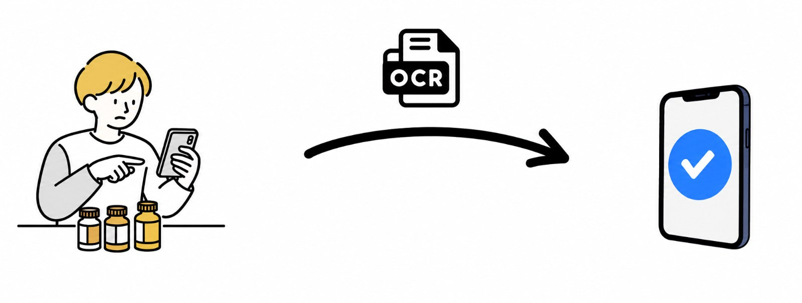
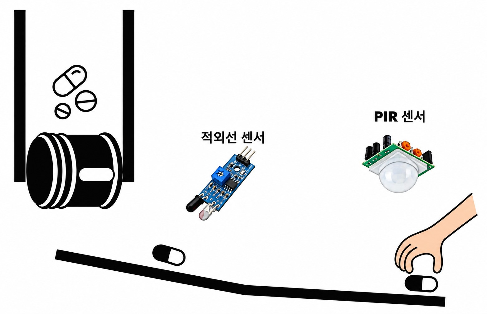

_앱 아이콘_

## 프로젝트 개요

- **프로젝트**: IoT&AI Open Platform Challenge (oneM2M/Mobius 기반)
- **기간**: 2026.06 ~ 2026.09 (3개월)
- **팀 / 담당**: 4명 / 백엔드, Flutter 앱 개발
- **기술**: Flutter, Dart, SQLite, MQTT, oneM2M(Mobius), OpenAI API, Google ML Kit, Arduino Uno R4 WiFi
- **링크**: <https://github.com/h-june-6/smaer_pill_dispenser>

## 1. 문제 인식

영양제 복용에는 세 가지 한계가 있다고 생각했다.

1. **식단과 무관한 복용**: 그날 먹은 식단과 상관없이 같은 영양제를 먹어 영양소 부족과 과잉이 반복된다.
2. **번거로운 성분 관리**: 영양제 성분을 일일이 확인하고 기록하기 어렵다.
3. **복용 확인 불가**: 복용을 잊거나, 실제로 먹었는지 확인할 방법이 없다.

그래서 **"식단을 분석해 부족한 영양소를 채울 영양제를 추천하고, 디바이스가 알약을 자동으로 꺼내 주며 복용까지 확인하는 시스템"** 을 목표로 삼았다.

## 2. 시스템 구조

시스템은 3단계로 동작한다.

- **기록**: 식단은 검색 또는 음식 사진(GPT-4o-mini Vision)으로 등록하고, 영양제는 성분표 사진을 OCR(ML Kit)로 읽어 등록한다.

- **추천**: 오늘 섭취량을 권장섭취량과 비교해 충족률을 계산한다. LLM이 토출할 영양제를 고르면, 앱에서 LLM 응답을 바탕으로 개수를 계산한다.

- **토출·확인**: 앱이 Mobius를 거쳐 Arduino에 토출 명령을 보낸다. 디바이스는 IR 센서로 낙하를, PIR 센서로 복용을, 초음파 센서로 잔량을 감지해 앱에 돌려준다.

_하드웨어를 단순화한 그림_

나는 이 중 **Flutter 앱 전체**와 **앱–Mobius–디바이스로 이어지는 End-to-End 통신**을 담당했다.

## 3. 기술적 고민과 해결

### 3-1. 개수까지 LLM에게 맡길 것인가

처음에는 LLM이 무엇을 몇 개 먹을지까지 정하게 할 생각이었다. 하지만 개수가 틀리면 곧바로 과복용으로 이어지므로, **판단과 계산을 분리**했다.

- LLM은 토출할 **약통 번호만** 고른다.
- 개수는 코드가 min(가장 부족한 영양소를 100%까지 채우는 수, 어떤 영양소도 권장량 200%를 넘지 않는 수)로 계산하고, 한 번에 **최대 3개**로 제한한다.
- 여러 약통을 함께 토출할 때는 앞 약통이 채운 양을 누적 반영해, 같은 영양소가 겹쳐도 과복용되지 않게 했다.

### 3-2. OCR과 AI 결과를 어디까지 믿을 것인가

OCR이 10mg을 100mg으로 읽으면 곧 복용량 오류가 된다. 그래서 OCR과 사진 분석 결과는 바로 저장하지 않고, **사용자가 확인·수정하는 화면**을 거치게 했다.

- 단위는 드롭다운으로 고정했다.
- IU처럼 영양소마다 환산식이 다른 단위는 코드에서 기준 단위로 변환한다.
- "비타민C"와 "비타민C(mg)"처럼 표기가 달라도 같은 영양소로 계산되도록 이름을 정규화했다.

### 3-3. Mobius 알림이 문서와 다르게 들어왔다

문서대로 구독을 설계했는데 디바이스에 알림이 오지 않았다. mosquitto\_sub로 전체 토픽을 구독해 **실제로 오가는 메시지를 직접 확인**했고, Mobius가 알림 토픽을 자체 규칙으로 생성한다는 것을 알아내 구독 설정을 고쳤다.

이후 같은 알림이 중복 전달되어 팝업이 여러 번 뜨는 문제가 생겼다. 리소스 ID(ri)를 기억해 **이미 처리한 메시지는 건너뛰도록** 해결했다.

### 3-4. 알약이 걸리거나 센서 구조가 바뀔 때

- 두 약통이 같은 낙하 통로를 쓰기 때문에, IR 센서를 합류 지점 하나로 줄이고 약통을 순차 토출하도록 바꿨다.
- 알약이 걸리면 0개로 끝나던 동작을, 낙하가 실제로 카운트될 때까지 **재시도**하도록 고쳤다.
- 서보가 움직이는 중에도 매 스텝 IR을 확인해 낙하를 놓치지 않게 했다.
- 요청한 개수를 다 세기 전에는 결과를 서버에 올리지 않아, 미완성 상태가 앱에 반영되지 않게 했다.

### 3-5. 앱이 꺼져 있어도 정해진 시간에 토출되게

Android Alarm Manager로 매일 지정한 시간에 백그라운드에서 **추천부터 토출까지 자동 실행**되게 했다.

- 앱이 꺼져 있었던 경우를 위해 **30분의 캐치업 윈도우**를 두었다.
- 같은 날 중복 토출을 막기 위해 마지막 실행 날짜를 저장한다.
- 명령 발행에 실패하면 상태를 되돌려 다시 시도할 수 있게 했다.

## 4. 구현 결과

| 기능 | 구현 내용 |
|---|---|
| 영양제 등록 | 성분표 사진 OCR 자동 인식 + 수동 입력, 단위 드롭다운 |
| 식단 기록 | 음식 검색, 사진 AI 분석, 월간 캘린더 조회·삭제 |
| 추천 | 충족률 계산 → LLM 선택 → 코드 개수 계산 (최대 3개, 권장량 200% 제한) |
| 디바이스 연동 | 토출 명령, 낙하 카운트(IR), 복용 감지(PIR), 잔량 측정(초음파) |
| 알림·예약 | 매일 자동 토출, 잔량 부족·토출 완료·복용 리마인더(1시간 간격) |

## 5. 한계 및 개선 방향

1. **영양소 데이터**: 내장 음식 DB가 23종으로 제한적이고, 사진 분석은 추정치라 오차가 있다. 공공 식품영양 DB를 연동하고, 사용자 수정 이력으로 사진 분석 결과를 보정하는 방향을 생각하고 있다.
2. **하드웨어 동작**: 낙하가 감지되지 않으면 재시도에 상한이 없어 장치가 멈춘 채 대기한다. 또한 복용 감지가 PIR 하나뿐이라 정확도에 한계가 있다. 재시도 횟수 상한, 앱 오류 알림, 약통별 복용 확인 방식으로 보완이 필요하다.

## 6. 배운 점

- 첫 공모전이자 팀 프로젝트로, 역할 분담, 소통 창구 정하기, 미팅 시간 효율화 등 **협업의 기본기**를 익혔다.
- IoT 연동에서는 문서를 믿기보다 **실제 패킷을 직접 확인**하는 것이 훨씬 빠르다는 것을 배웠다.
- OCR이나 AI처럼 틀릴 수 있는 입력에는 **사용자가 확인하는 단계**를 두는 것이 서비스 신뢰도에 중요하다고 느꼈다.
