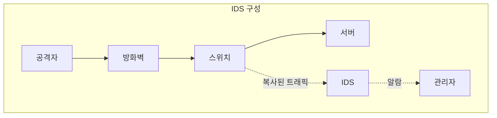
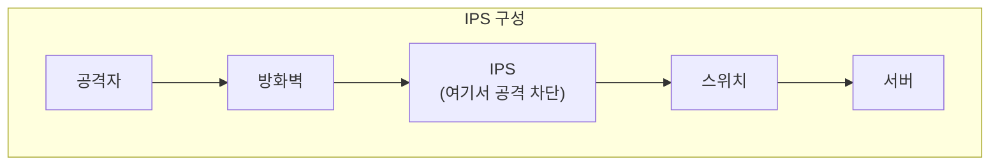
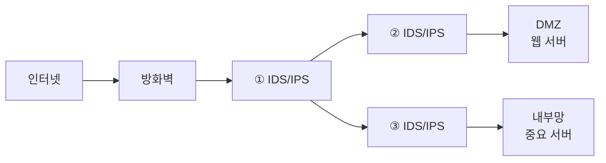

## 왜 필요할까

인터넷의 데이터는 **패킷** 단위로 전송된다. 패킷은 IP 주소와 포트 같은 배송 정보가 담긴 **헤더**와, 실제 내용이 담긴 **페이로드**로 이루어진다.

전통적인 방화벽은 헤더만 검사한다. 그런데 웹 서버는 80번, 443번 포트를 열어 둘 수밖에 없고, SQL Injection 같은 공격도 이 포트로 들어오는 평범한 HTTP 요청의 페이로드에 담겨 온다. 헤더만 보면 정상 요청과 공격이 똑같아 보이기 때문에, 페이로드까지 검사하는 시스템이 필요하다. 그게 IDS와 IPS다.

## IDS와 IPS란

건물 보안에 빗대면 다음과 같다.

- **방화벽**: 출입 명단만 확인하는 사람. 가방 안은 확인하지 않는다.
- **IDS**: CCTV와 경보 장치. 수상한 행동을 보면 경보를 울리지만 직접 막지는 않는다.
- **IPS**: 가방까지 검사하는 보안 요원. 위험물을 발견하면 그 자리에서 막는다.

**IDS**는 공격으로 의심되는 활동을 발견하면 알람을 발생시킨다. **IPS**는 여기에 차단 기능을 더해, 공격 패킷을 폐기하거나 연결을 끊는다.

두 시스템의 핵심 차이는 **탐지한 뒤 어떻게 대응하느냐**이고, 이 차이는 설치 위치에서 드러난다.





IDS는 복사된 트래픽을 옆에서 분석하므로 공격은 서버까지 그대로 전달된다. IPS는 경로 위에 서 있어서 공격이 서버에 닿기 전에 막을 수 있다.

## 동작 원리


1. **패킷 수집**: IDS는 복사된 패킷을, IPS는 실제로 지나가는 원본 패킷을 수집한다.
2. **디코딩**: 헤더를 해석해서 프로토콜 종류와 페이로드 위치를 파악한다.
3. **전처리**: 쪼개진 패킷을 다시 이어 붙이고, `%27` 같은 인코딩을 원래 문자(`'`)로 바꾼다(정규화). 이 단계가 없으면 공격을 쪼개거나 인코딩만 바꿔도 탐지를 피할 수 있다.
4. **탐지 엔진**: 정리된 데이터를 기준과 비교해서 공격인지 판단한다.
5. **알람 또는 차단**: IDS는 알람을 남기고, IPS는 패킷을 폐기하거나 연결을 끊는다.

1~4단계는 IDS와 IPS가 같고, 5단계에서만 갈린다.

## 유형

IDS와 IPS는 감시 대상, 탐지 방식, 대응 방식에 따라 나뉜다. 

### IDS의 종류

| 분류 기준 | 종류 |
| --- | --- |
| 감시 대상 | NIDS, HIDS, WIDS |
| 탐지 방식 | 시그니처 기반, 이상 행위 기반, 상태 기반 프로토콜 분석 |
| 대응 방식 | 수동형, 능동형 |

#### 감시 대상에 따른 종류

앞 글자 N, H, W는 각각 Network, Host, Wireless를 뜻한다.

- **NIDS**: 네트워크 구간에서 유선 패킷을 감시한다. 스위치의 미러링 포트(SPAN)나 케이블에 끼우는 복사 장비(TAP)로 트래픽을 받아 온다. 한 대로 넓은 구간을 볼 수 있지만, 암호화된 트래픽(HTTPS)의 내용은 볼 수 없다. Snort, Suricata, Zeek이 대표적이다.
- **HIDS**: 서버 안에 설치되어 로그, 파일 변경, 프로세스 실행을 감시한다. 공격이 실제로 성공했는지 확인할 수 있지만, 서버마다 따로 설치해야 한다. Wazuh, OSSEC이 대표적이다.
- **WIDS**: 무선 신호를 감시해서 허가되지 않은 AP나 비정상적인 무선 접속을 탐지한다.

NIDS와 HIDS는 서로 못 보는 부분이 달라서 함께 운영하는 경우가 많다.

#### 탐지 방식에 따른 종류

| 방식 | 판단 기준 | 예시 | 강점 | 약점 |
| --- | --- | --- | --- | --- |
| 시그니처 기반 | 알려진 공격 패턴과 일치하는가 | URI에 `union`과 `select`가 함께 있으면 SQL Injection으로 의심 | 정확하고 알람 원인이 명확함 | 제로데이 공격과 변형된 공격을 놓침 |
| 이상 행위 기반 | 평소 상태에서 크게 벗어났는가 | 초당 100건이던 로그인 요청이 5,000건으로 급증 | 처음 보는 공격도 잡을 수 있음 | 정상적인 변화도 공격으로 오인하기 쉬움 |
| 상태 기반 프로토콜 분석 | 프로토콜의 정상 절차를 벗어났는가 | FTP에서 로그인 없이 파일 전송 명령이 들어옴 | 프로토콜 악용 공격에 강함 | 프로토콜마다 분석 기능이 필요함 |

실제 제품은 여러 방식을 함께 쓰는 경우가 많다.

#### 대응 방식에 따른 종류

- **수동형 IDS**: 알람만 남긴다. 보통 IDS라고 하면 이 방식이다.
- **능동형 IDS**: 공격을 탐지하면 연결을 끊는 신호(TCP RST)를 보내거나, 방화벽에 차단 규칙 추가를 요청한다. 다만 경로 밖에 있어서 이미 서버에 도착한 패킷은 막지 못하고, 이후 통신만 끊을 수 있다.

### IPS의 종류

| 분류 기준 | 종류 |
| --- | --- |
| 감시 대상 | NIPS, HIPS, WIPS |
| 탐지 방식 | IDS와 동일 |
| 대응 방식 | 패킷 폐기, 거부 응답 전송, 연결 종료, 출발지 IP 차단, 트래픽 제한 |

- **NIPS**: 모든 트래픽이 자신을 거치도록 경로 한가운데에 설치된다(인라인).
- **HIPS**: 서버 안에서 허가되지 않은 프로그램 실행이나 시스템 파일 수정을 직접 막는다.
- **WIPS**: 허가되지 않은 무선 AP나 단말의 연결을 끊는다.

IPS는 잘못 판단하면 정상 트래픽이 막히기 때문에, 정확한 시그니처 기반 탐지를 차단에 주로 쓰고 이상 행위 기반 탐지는 알람이나 트래픽 제한 정도로 쓰는 경우가 많다.

## 활용 방법

### 설치 위치



1. **방화벽 바로 뒤**: 방화벽이 헤더로 걸러 낸 트래픽을 페이로드까지 다시 검사한다.
2. **DMZ 앞**: 외부에 공개된 웹 서버 구간으로, 공격이 가장 많이 몰린다.
3. **내부망 앞**: 이미 들어온 공격자가 다른 서버로 옮겨 가는 것까지 탐지한다.

처음부터 차단을 켜면 정상 서비스가 막힐 수 있으므로, 보통은 IDS 모드로 먼저 운영하면서 잘못 걸리는 룰을 조정한 뒤 검증된 룰에만 차단을 적용한다.

### 룰 작성: Suricata 예시

Snort와 Suricata는 룰 문법이 거의 같다. 괄호 앞의 헤더는 "어떤 트래픽에 적용할지"를, 괄호 안의 옵션은 "무엇을 찾을지"를 정한다. 맨 앞의 액션이 `alert`면 알람만, `drop`이면 패킷 폐기, `reject`면 폐기와 함께 거부 응답을 보낸다.

```text
alert http $EXTERNAL_NET any -> $HOME_NET any ( \
    msg:"[Custom] Possible SQLi - UNION SELECT in URI"; \
    flow:established,to_server; \
    http.uri; content:"union"; nocase; content:"select"; nocase; distance:0; within:30; \
    sid:1000001; rev:1;)
```

| 옵션 | 의미 |
| --- | --- |
| `flow:established,to_server` | 연결이 맺어진 뒤 서버로 가는 트래픽만 검사 |
| `http.uri` | 요청 주소(URI)만 검사 |
| `nocase` | 대소문자 무시 |
| `distance:0; within:30` | `union`이 끝난 위치부터 30바이트 안에서 `select`를 찾음 |
| `sid` | 룰 번호 (직접 만든 룰은 보통 1000000 이상) |

외부에서 들어오는 HTTP 요청의 주소에 `union` 뒤로 가까이 `select`가 있으면 알람을 발생시키는 룰이다. 인코딩이나 주석(`/**/`)으로 변형한 공격까지 잡으려면 룰을 더 추가해야 한다.

### IDS 모드와 IPS 모드

같은 Suricata도 실행 방법에 따라 IDS가 되기도, IPS가 되기도 한다.

```bash
# IDS 모드: eth0으로 들어오는 패킷을 분석만 함
sudo suricata -c /etc/suricata/suricata.yaml -i eth0

# IPS 모드: 이 장비를 지나가는 패킷을 Suricata가 검사한 뒤 통과/차단
sudo iptables -I FORWARD -j NFQUEUE --queue-num 0
sudo suricata -c /etc/suricata/suricata.yaml -q 0
```

IDS 모드에서 다른 장비의 통신까지 보려면 SPAN이나 TAP으로 트래픽을 eth0에 전달해야 한다. IPS 모드는 리눅스 장비가 라우터처럼 통신을 중계할 때 쓰며, Suricata가 꺼지면 통신이 막힐 수 있으므로 테스트 환경에서 실습해야 한다. IPS 모드에서 룰의 `alert`를 `drop`으로 바꾸면 해당 패킷이 실제로 버려진다.

## 장단점

| | IDS | IPS |
| --- | --- | --- |
| 장점 | 고장 나도 통신에 영향 없음, 설치와 제거가 쉬움 | 공격이 서버에 닿기 전에 자동 차단 |
| 단점 | 공격이 도착한 뒤에 탐지, 사람이 대응해야 해서 느림, 알람이 쌓이면 무시하게 됨(alert fatigue) | 성능이 부족하면 네트워크가 느려짐, 고장 시 통신 단절 가능, 오탐이 곧 서비스 차단 |

IPS가 고장 났을 때 트래픽을 그냥 통과시킬지(Fail-open), 모두 막을지(Fail-close)는 미리 설정할 수 있다. 서비스 유지가 중요하면 Fail-open, 보안이 중요하면 Fail-close를 고른다.

두 시스템 모두 암호화된 트래픽은 따로 복호화하지 않으면 내용을 검사할 수 없다. 또 탐지 결과에는 항상 **오탐**(정상을 공격으로 판단)과 **미탐**(공격을 놓침)이 섞인다. 룰을 엄격하게 하면 미탐이 줄고 오탐이 늘며, 느슨하게 하면 반대가 된다. 이 균형을 맞추는 룰 튜닝이 운영의 핵심이다.

## 차이점 정리

| 구분 | 방화벽 | IDS | IPS |
| --- | --- | --- | --- |
| 목적 | 허용된 트래픽만 통과 | 공격 탐지 | 공격 탐지와 차단 |
| 검사 대상 | 헤더 (IP, 포트) | 헤더와 페이로드 | 헤더와 페이로드 |
| 설치 방식 | 경로 위 | 경로 옆 (복사된 트래픽) | 경로 위 (인라인) |
| 차단 | O | 기본적으로 X | O |
| 오탐의 결과 | - | 불필요한 알람 | 정상 트래픽 차단 |

세 장비는 서로를 대체하지 않는다. 방화벽이 헤더로 1차로 거르고, IDS/IPS가 페이로드까지 열어서 2차로 검사하는 식으로 함께 쓴다.

## 마무리

IDS는 공격을 탐지해서 알리고, IPS는 탐지한 공격을 직접 막는다. 판단하는 과정은 같지만, 막으려면 트래픽의 길목에 서 있어야 하기 때문에 IPS는 바로 막을 수 있는 대신 잘못 막으면 서비스가 멈추는 부담을 함께 진다.

## 참고

- [Suricata Docs - Rules](https://docs.suricata.io/en/latest/rules/index.html)
- [Snort](https://www.snort.org/)
- [IPwithease - Difference between IPS and IDS in Network Security](https://ipwithease.com/difference-between-ips-and-ids-in-network-security/)
- [NIST SP 800-94, Guide to Intrusion Detection and Prevention Systems](https://csrc.nist.gov/pubs/sp/800/94/final)
