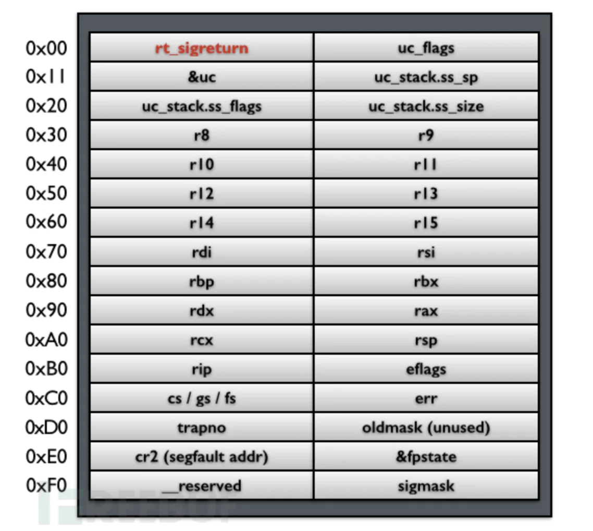
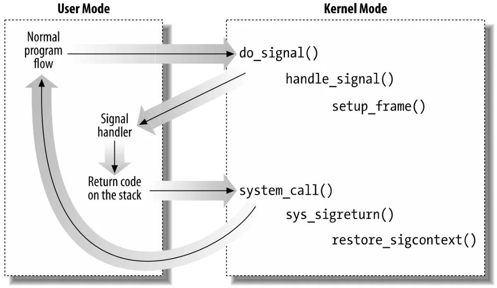
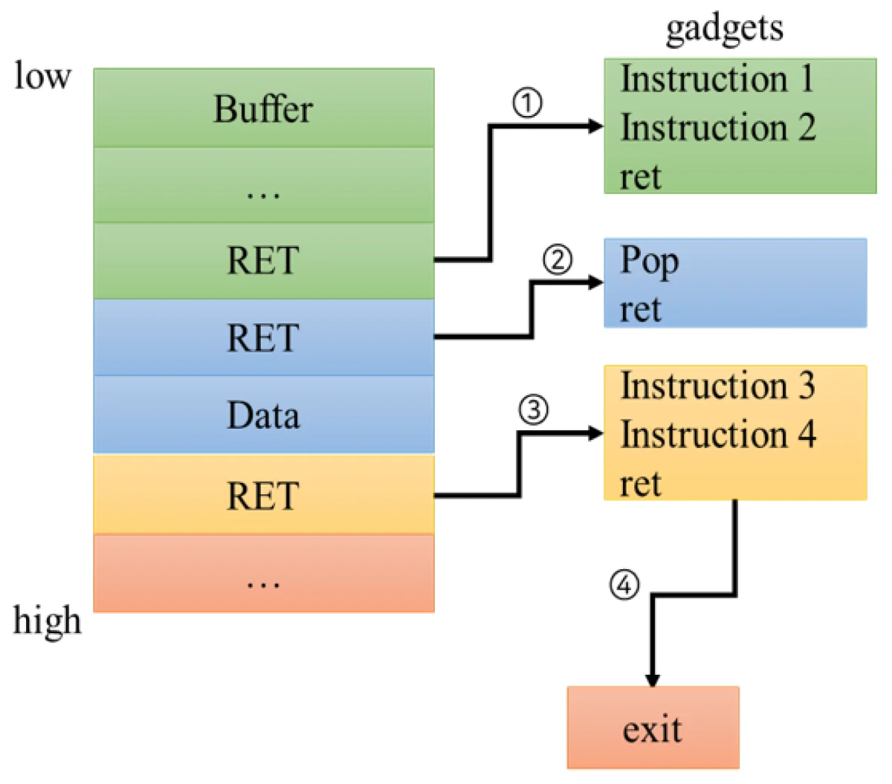

-   **저자:** Marcos Bajo, Ritvik Goyal, Apostolos Chatzianagnostou,
    Christian Rossow
-   **학회:** IEEE Symposium on Security and Privacy (IEEE S&P), 2026
-   **분야:** 시스템 보안, 코드 재사용 공격, 제어 흐름 보호
-   **논문:** [Crashing Through Defenses: Exploiting Segfaults and
    Chaining around Intel
    CET](https://syssec.cispa.de/papers/sfop-ieeesp2026.pdf)

## 0. 읽기 전 정리

이 논문은 Intel CET가 적용된 Linux 환경에서 메모리 손상 취약점을 이용해 
공격을 이어가는 SFOP를 제안한다. 
이름처럼 프로그램에서 발생하는 Segmentation Fault를 공격 과정에 활용하는 기법이다.

앞에서 언급한 CET는 ROP와 같은 코드 재사용 공격을 막기
위해 도입된 하드웨어 보안 기능이다.

CET가 활성화된 환경에서 공격자가
어떻게 실행 흐름을 조작할 수 있었을까? 저자들은 CET 기능
자체보다 Signal Handler을 이용했다.
Signal Handler는 프로그램이 오류로 인해 비정상적인 상황에 빠졌을 때 운영체제가 처리하는 과정이고
이 signal 중 하나가 SIGSEGV이다.

SIGSEGV는
프로그램이 접근해서는 안 되는 메모리 주소에 접근하면 발생하는 오류이다.

예를 들어

```c
int *ptr = NULL;
*ptr = 10;
```

이런 코드에서 ptr이 가리키는 주소는 NULL인데 여기에 값을 쓰려고 하면 일반적으로 SIGSEGV가 발생한다.

근데 이 논문에서는 이러한 SIGSEGV를 일부로 잘못된 메모리 접근을 하여 의도적으로 발생시킨다.

그럼 왜 시그널 핸들러를 발생시키려는걸까?

Linux의 시그널 처리 과정을 보면 다음과 같다.

```text
잘못된 메모리 접근
        ↓
SIGSEGV 발생
        ↓
커널이 CPU 실행 상태를 sigframe에 저장
        ↓
Signal Handler 실행
        ↓
sigreturn을 통해 기존 실행 상태 복구
```

여기서 핵심은 마지막이다.

커널이 sigframe에 저장된 정보를 바탕으로 CPU의 실행 상태를 복구한다는 점이다.
이 복구 과정을 SFOP에서 이용하려고 SIGSEGV를 발생시켜 Signal Handler를 실행하도록 만든 것이다.

기존 CET 우회 연구 중에는 C++ 가상 함수나 코루틴처럼 프로그램 내부의
특정 구조를 이용하는 방식이 있었다. 이런 방법은 해당 구조가 없는
프로그램에 그대로 적용하기 어렵다. SFOP는 Linux의 시그널 처리 기능을
이용해 공격을 연결한다는 점에서 다른 접근을 취한다.

## 1. 배경과 문제 정의

### 1-1. 연구 배경

Intel CET는 프로그램의 실행 흐름이 공격자에 의해 변조되는 것을 어렵게
만드는 기술이다. 주요 기능은 Shadow Stack과 IBT다. 
Shadow Stack은 함수가 반환할 때 일반 스택에 저장된 반환
주소와 별도로 보관된 주소를 비교한다. 공격자가 반환 주소를 바꾸면 두
값이 달라져 이를 탐지한다. IBT는 간접 호출이나 점프가 허용된 진입점으로
향하는지 확인한다.

저자들이 주목한 부분은 CET와 Linux의 Signal Handling이 함께 동작하는
과정이다. Signal은 프로세스에 특정 사건이 발생했음을 알리는 운영체제
기능이다. 예를 들어 잘못된 메모리 접근으로 SIGSEGV가 발생하면 운영체제는
등록된 Signal Handler를 실행한다. 이 과정에서는 중단된 프로그램의 실행
상태를 저장하고, Handler가 끝난 뒤 `rt_sigreturn`을 통해 실행 상태를
복원한다.

논문은 이 시그널 처리 과정과 CET의 보호 기능 사이에서 공격자가 이용할 수
있는 지점을 찾아낸다.

### 1-2. 위협 모델

논문에서 SFOP는 이미 메모리 손상 취약점을 확보한 공격자가 사용하는 후속
공격 기법이다. 공격자는 메모리 정보를 파악하거나 메모리 내용을 변조할 수
있고, 포인터를 조작할 수 있다고 가정한다. CET와 DEP/NX, Full RELRO 등
여러 방어 기법이 적용된 환경에서도 공격이 가능한지를 분석한다.

## 2. 핵심 아이디어와 방법론

### 2-1. SFOP의 동작 원리

논문에서는 SFOP를 두 가지 방식으로 구분한다.

- **fSFOP(Forward SFOP):** SIGSEGV를 반복적으로 발생시키고 Signal Handler를 재실행하는 방식으로 공격 체인을 구성한다.
- **bSFOP(Backward SFOP):** Shadow Stack에 값을 주입하고 Shadow Stack Pointer(SSP)를 조작해 반환 주소 검사를 우회하는 방식으로 공격 체인을 구성한다.

이하에서는 반복적인 시그널 처리를 이용하는 fSFOP의 동작 과정을 설명한다.

**① 메모리 손상 취약점을 이용한 초기 제어 흐름 확보**

공격자는 포인터를 이용해 실행 흐름을 가로채고, 이후 CET의 IBT 검사를 통과할 수 있는 `endbr64` 기반 Gadget을 연결한다. 각 Gadget은 간접 호출 또는 간접 점프로 다음 Gadget에 제어를 전달한다. 이 Gadget Chain을 통해 `sigaction()` 호출에 필요한 인자를 준비하고, 공격자가 지정한 SIGSEGV Handler를 등록하는 단계까지 도달한다.

**② `sigaction()`을 이용한 SIGSEGV Handler 등록**

Linux에서 `sigaction()`은 특정 시그널이 발생했을 때 실행할 사용자 정의 함수를 등록하는 인터페이스다. SFOP에서는 이 기능을 이용해 공격자가 제어할 수 있는 Signal Handler를 SIGSEGV에 등록한다.

`sigaction()`은 다음 세 가지 인자를 받는다.

| 인자     | 역할                                   |
|:---------|:---------------------------------------|
| `signum` | Handler를 등록할 시그널 번호           |
| `act`    | 새로 등록할 Handler의 정보             |
| `oldact` | 기존 Handler 정보를 저장할 메모리 주소 |

`act`에는 실행할 Handler의 주소와 시그널 마스크, 플래그 등의 정보가 들어간다. `sa_flags`는 시그널 처리 방식을 지정하며, 논문에서 다루는 시그널 중첩 처리와 관련된 옵션도 이 부분에 해당한다.

공격자는 앞 단계에서 구성한 Gadget Chain으로 `sigaction()`을 호출하고, SIGSEGV Handler와 필요한 옵션을 등록한다. 이 단계의 목적은 이후 SIGSEGV가 발생했을 때 커널이 공격자가 지정한 Handler로 제어를 전달하도록 만드는 것이다.

**③ Early Kill을 이용한 즉각적인 SIGSEGV 발생**

Handler를 등록한 다음에는 실제로 SIGSEGV를 발생시켜야 한다. 논문에서는 이를 위해 `sigaction()` 함수 내부의 잘못된 메모리 접근을 이용하는 **Early Kill** 기법을 제시한다.

`oldact`는 기존 시그널 처리 정보를 저장하기 위한 포인터다. 공격자는 이 인자에 유효하지 않은 메모리 주소를 전달한다. 새로운 Handler를 등록하는 커널 측 처리가 먼저 이루어진 뒤, libc가 기존 Handler 정보를 `oldact`가 가리키는 메모리로 복사하는 과정에서 잘못된 주소에 접근해 SIGSEGV가 발생한다.

따라서 새 Handler가 등록된 직후 같은 `sigaction()` 호출 과정에서 오류가 발생하고, 방금 등록한 Handler가 실행된다. 별도의 프로세스가 시그널을 보내거나 이후 프로그램 동작에서 우연히 오류가 발생하기를 기다리지 않아도 공격 흐름을 다음 단계로 연결할 수 있다.

{: width="560" }
_x86-64 Linux Signal Frame 구조. 일반적인 Signal Frame을 개념적으로 보여 주는 그림으로, SFOP 논문의 프레임 구조와 완전히 같지는 않다. (출처: [angold4, Sigreturn Oriented Programming Attack](https://angold4.wordpress.com/2021/02/01/sigreturn-oriented-programming-attack/))_

**④ Sigframe Pivoting을 이용한 실행 상태 조작**

SIGSEGV가 발생하면 Linux 커널은 Signal Handler를 실행하기 전에 현재 CPU의 실행 상태를 저장한다. 이때 생성되는 자료구조가 `sigframe`이다. 이 프레임에는 레지스터 상태를 담은 `ucontext`, 시그널 정보를 담은 `siginfo` 등이 포함된다.

`ucontext` 내부의 `sigcontext`에는 RIP, RSP 및 함수 인자 전달에 사용하는 레지스터 등이 저장된다. 커널은 `sigframe`을 스택에 배치한 후 RIP를 등록된 Signal Handler 주소로 설정하고, RDI·RSI·RDX에는 각각 시그널 번호, `siginfo` 주소, `ucontext` 주소를 전달한다.

일반적인 시그널 처리에서는 Handler가 종료되면 복귀 코드인 Restorer가 실행되고, 이 코드가 `rt_sigreturn` 시스템 콜을 호출한다. 커널은 이때 스택에 놓인 시그널 프레임을 바탕으로 CPU 실행 상태를 복구한다.

SFOP는 이 동작을 이용한다. **Sigframe Pivoting은 Signal Handler 실행 중 RSP를 변경하여, 이후 `rt_sigreturn`이 참조할 실행 상태의 위치를 공격자가 준비한 메모리 영역으로 전환하는 기법이다.** 공격자는 미리 위조된 실행 상태를 메모리에 배치하고, Handler 실행 과정에서 RSP가 해당 영역을 가리키도록 만든다. 이후 `rt_sigreturn`이 실행되면 커널은 공격자가 준비한 레지스터 값과 실행 위치를 복구하게 된다.

논문은 다음과 같은 Pivoting 방법을 제시한다.

| 기법                             | 동작 원리                                                                                                |
|:---------------------------------|:---------------------------------------------------------------------------------------------------------|
| Classic Sigframe Pivoting        | `leave; ret` Gadget을 이용해 RSP를 RBP가 가리키는 위치로 이동                                            |
| Unwinding-based Pivoting         | 스택 프레임에 연결된 RBP 값들을 따라가며 공격자가 준비한 위치로 이동                                     |
| Double-Partial Sigframe Pivoting | RBP가 공격자가 제어하는 메모리를 직접 가리키지 않는 상황에서도 부분적인 스택 조작을 조합해 Pivoting 수행 |


_커널이 Signal Frame을 만들고 Handler를 실행한 뒤 `sigreturn`으로 실행 상태를 복구하는 흐름 (출처: [OS 강의 자료 lec10](https://os-lecture.github.io/2023S-os-lectures/lec10/p1-ipcoverview.html))_

**⑤ `rt_sigreturn`을 이용한 공격자 제어 실행 상태 복구**

Sigframe Pivoting이 성공하면 Signal Handler는 Restorer로 복귀하고, `__restore_rt`가 `rt_sigreturn` 시스템 콜을 실행한다.

일반적인 상황에서 `rt_sigreturn`은 시그널 발생 이전의 실행 상태를 복구하는 기능이다. 그러나 SFOP에서는 RSP를 공격자가 준비한 프레임 위치로 이동시켰기 때문에, 커널이 복구하는 실행 상태도 공격자가 구성한 값으로 바뀐다.

공격자는 이를 통해 다음과 같은 레지스터를 설정할 수 있다.

| 레지스터    | 용도                                |
|:------------|:------------------------------------|
| RIP         | 다음에 실행할 함수 또는 명령어 주소 |
| RSP         | 다음 실행에 사용할 스택 위치        |
| RDI         | 함수의 첫 번째 인자                 |
| RSI         | 함수의 두 번째 인자                 |
| RDX         | 함수의 세 번째 인자                 |
| RCX, R8, R9 | 나머지 함수 인자                    |

x86-64 Linux의 System V AMD64 ABI에서는 정수형 또는 포인터형 함수 인자 6개가 RDI, RSI, RDX, RCX, R8, R9 순서로 전달된다. 따라서 공격자는 `rt_sigreturn`으로 RIP와 인자 전달 레지스터를 설정해 원하는 함수를 지정한 인자로 실행할 수 있다.

여기서 CET의 IBT와 관련된 문제가 발생한다. 논문은 커널이 `rt_sigreturn`으로 CPU 레지스터를 복구할 때 복구 대상 RIP에 대해 IBT 검사를 수행하지 않는 동작을 공격에 활용한다. 이를 통해 공격자는 일반적인 간접 분기에서 요구되는 유효한 IBT 진입점 제한을 우회할 수 있다.

다만 `rt_sigreturn`으로 RIP를 복구하는 것만으로 CET의 Shadow Stack 문제까지 자동으로 해결되는 것은 아니다. 함수가 반환할 때 Shadow Stack 검사에 걸릴 수 있으며, fSFOP는 이 검사 실패로 발생하는 SIGSEGV를 다음 공격 단계로 연결한다.

**⑥ Infinite Segfault Looping을 통한 다중 함수 호출**

한 번의 `rt_sigreturn`으로 원하는 함수를 실행하는 것만으로는 여러 함수를 순서대로 호출하기 어렵다. 함수가 반환하는 과정에서 일반 스택과 Shadow Stack의 반환 주소가 일치하지 않으면 CET의 Shadow Stack 검사가 실패할 수 있기 때문이다.

논문에서 주목한 부분은 이러한 CET 위반 처리 과정에서 SIGSEGV가 발생하고, 이미 등록된 SIGSEGV Handler가 다시 실행될 수 있다는 점이다. 공격자는 이 동작을 이용해 다음과 같은 반복 구조를 만든다.

1.  `rt_sigreturn`으로 공격자가 지정한 함수에 진입한다.
2.  함수가 실행된 뒤 반환을 시도한다.
3.  Shadow Stack 검사 실패로 SIGSEGV가 발생한다.
4.  미리 등록한 Signal Handler가 다시 실행된다.
5.  Handler에서 Sigframe Pivoting을 수행한다.
6.  다음 `rt_sigreturn`으로 새로운 실행 상태를 복구하고 다음 함수를 실행한다.

이 과정이 반복되면 공격자는 여러 함수를 차례로 실행할 수 있다. 논문은 이 반복 구조를 **Infinite Segfault Looping**이라고 부른다.

이 과정에서 RBP와 스택 프레임의 상태를 유지하는 것이 중요하다. 논문은 함수 호출 규약과 스택 프레임의 특성을 이용해 다음 Handler 실행에서도 Pivoting에 필요한 상태를 확보한다. 또한 시그널이 처리되는 동안 동일한 시그널이 차단되는 기본 동작을 고려해 중첩 시그널 처리 조건을 구성한다.

결과적으로 fSFOP는 메모리 손상 취약점으로 시작한 공격을 `sigaction()` 호출, Early Kill, Sigframe Pivoting, `rt_sigreturn`, CET 위반에 따른 SIGSEGV 재발생으로 연결한다. 이 반복 구조를 통해 CET가 활성화된 환경에서도 여러 함수를 공격자가 지정한 인자로 실행하는 코드 재사용 공격을 구성한다.

{: width="520" }
_일반적인 ROP 공격에서 Gadget이 `ret`으로 연결되는 구조. SFOP의 공격 체인 그림이 아니라 비교용 그림이다. (출처: S. Lee, J. Cho, [ACE-M](https://www.mdpi.com/2079-9292/11/6/912), Electronics, 2022, CC BY 4.0)_

### 핵심 정리

fSFOP의 핵심은 SIGSEGV 자체가 아니라, **SIGSEGV 발생과 커널의 실행 상태 복구 과정을 반복적인 코드 재사용 공격의 연결 장치로 활용한다는 점**이다.

| 구분             | 일반적인 ROP                                | fSFOP                                     |
|:-----------------|:--------------------------------------------|:------------------------------------------|
| 공격 출발점      | 메모리 손상 취약점                          | 메모리 손상 취약점                        |
| 공격 체인 구성   | Gadget의 `ret` 연결                         | Signal Handler와 `rt_sigreturn` 반복      |
| 실행 상태 조작   | 스택 및 레지스터 조작                       | Sigframe Pivoting                         |
| 다음 단계로 이동 | Gadget의 반환 주소                          | SIGSEGV 재발생 및 Handler 재실행          |
| CET 대응         | Shadow Stack에 의해 반환 주소 변조가 탐지됨 | CET와 Linux 시그널 처리의 상호작용을 악용 |

## 3. 실험과 평가, 한계

### 3-1. 실험

저자들은 여러 PoC를 통해 제안한 공격을 검증하고, 실제 프로그램에도 적용
사례를 제시한다. 실제 프로그램 사례로는 Nginx와 Ladybird가 등장한다.

Nginx 사례에서는 Nginx 1.4.0의 CVE-2013-2028 취약점을 이용한다. HTTP
요청 처리 과정에서 발생하는 메모리 손상 취약점을 출발점으로 삼아 fSFOP를
적용하고, 명령 실행으로 이어질 수 있음을 보인다.

Ladybird 사례에서는 CVE-2021-4327을 이용한다. 메모리 손상 취약점으로
공격 조건을 만든 뒤 fSFOP를 적용한다. 두 사례는 서로 다른 프로그램에서도
같은 공격 아이디어가 적용될 수 있음을 보여준다.

두 사례를 읽으면서 눈에 띈 점은 실제 프로그램에 적용한 공격이 fSFOP라는
것이다. bSFOP는 별도의 PoC를 통해 검증한 결과와 구분해서 평가할 필요가
있다.

### 3-2. 방어와 패치

저자들은 Linux 커널의 시그널 처리 과정에서 SFOP가 이용하는 동작을
제한하는 방어책도 논의한다. 핵심은 Signal Handler 등록과 Signal Frame
복원 과정에서 공격자가 실행 상태나 Shadow Stack을 임의로 조작하지
못하도록 검증을 강화하는 것이다. 논문은 Custom Restorer 검증,
`rt_sigreturn` 처리 과정의 검증, Signal Frame 관련 보호 등을 다룬다.

저자들의 평가에서 제안한 패치는 bSFOP를 차단하지만, fSFOP는 일부
완화하는 데 그친다. fSFOP를 완전히 막으려면 추가적인 커널 수준의 보호가
필요하다고 설명한다. 패치가 두 공격 방식에 동일한 효과를 내지 못한다는
점이 흥미로웠다.

### 3-3. 한계와 아쉬운 점

아쉬웠던 부분은 실제 프로그램에 적용한 사례가 제한적이라는 점이다.
Nginx와 Ladybird에서 공격 가능성을 보였지만, 이를 근거로 다양한 Linux
프로그램에서도 같은 조건으로 공격할 수 있다고 단정하기는 어렵다.
프로그램마다 메모리 구조와 시그널 처리 방식, 이용할 수 있는 취약점이
다르기 때문이다.

공격 성공률이나 실행 시간, 시스템 성능에 미치는 영향을 더 폭넓게
비교했다면 실제 환경에서 공격이 얼마나 현실적인지 판단하는 데 도움이
되었을 것 같다. bSFOP도 실제 프로그램에 적용한 사례가 추가된다면
fSFOP와의 차이를 더 분명하게 이해할 수 있을 것이다.

## 4. 느낀 점과 배운 점

ROP를 처음 접할 때도 이런 생각을 어떻게 해내지? 하는 의문이 들 정도로 
내 입장에선 새로운 패러다임이다.. 라는 느낌이였는데 이 논문도 비슷한 충격을
주었다. 프로그램의 예외 상황을 처리하는 기능으로만
생각했던 시그널 처리가 공격 표면이 될 수 있다는 점이 흥미로웠다.

그동안 시스템 해킹을 공부하면서는 주로 스택이나 힙의 메모리 구조, 반환
주소 변조처럼 프로그램 내부의 메모리 조작에 집중했다. 이번 논문을 읽고
나서는 공격자가 메모리를 변조한 다음 운영체제가 그 상태를 처리하는
과정까지 공격에 활용할 수 있다는 점을 알게 됐다. 앞으로는 취약한 코드뿐
아니라 커널이 사용자 공간의 실행 상태를 저장하고 복원하는 방식도 함께
공부해 보고 싶다.

## 5. 앞으로 할 것

### 5-1. 더 읽어볼 논문

이번 논문과 직접 연결되는 SROP, COOP, CFI 관련 연구를 이어서 읽어볼
계획이다.

-   Yingjie Guo, Liwei Chen, and Gang Shi, "Function-Oriented
    Programming: A New Class of Code Reuse Attack in C Applications,"
    IEEE Conference on Communications and Network Security (CNS), 2018.
    함수 단위의 코드 재사용 공격을 SFOP와 비교해 보고 싶다.
-   Marcos Bajo and Christian Rossow, "Await() a Second: Evading Control
    Flow Integrity by Hijacking C++ Coroutines," USENIX Security
    Symposium, 2025. 코루틴을 이용한 제어 흐름 보호 우회와 SFOP의 차이를
    확인하고 싶다.

### 5-2. 다른 분야로의 확장

후속 연구로는 ARM64 환경에서 비슷한 문제가 발생하는지 확인해 볼 수 있을
것 같다. ARM에는 PAC와 BTI처럼 포인터와 제어 흐름을 보호하는 기능이
있다. Intel CET와 구현 방식은 다르지만, 하드웨어 보호 기능과 운영체제의
예외 처리 과정이 만나는 지점을 비교하면 의미 있는 연구가 될 것 같다.

### 5-3. 재현해 보고 싶은 부분

논문 저자들이 공개한 [SFOP GitHub
저장소](https://github.com/signal-sfop/sfop)를 이용해 fSFOP와 bSFOP의
차이를 직접 확인해 보고 싶다.

처음부터 실제 프로그램의 취약점을 재현하기보다는, 먼저 저장소에서
제공하는 PoC로 Signal Handler와 Signal Frame이 어떻게 연결되는지 확인할
계획이다. 그다음 CET의 Shadow Stack이 활성화된 상태에서 공격 흐름이
어떻게 달라지는지 비교해 보고 싶다. 

### 5-4. 연구 방향

이 논문을 읽고 운영체제의 예외 처리 과정과 제어 흐름 보호가 만나는
부분을 더 공부해 보고 싶어졌다. 공격 관점에서는 Signal Handling 외에
다른 예외 처리 과정에서도 비슷한 우회 가능성이 있는지 분석할 수 있을 것이고
방어 관점에서는 커널이 사용자 공간의 실행 상태를 복원하기 전에 어떤
검증을 해야 하는지 생각하면 대응책을 만들 수 있을 것이다.

## 참고 자료

1.  Marcos Bajo, Ritvik Goyal, Apostolos Chatzianagnostou, and Christian
    Rossow, "Crashing Through Defenses: Exploiting Segfaults and
    Chaining around Intel CET," IEEE Symposium on Security and
    Privacy, 2026. [논문
    PDF](https://syssec.cispa.de/papers/sfop-ieeesp2026.pdf)
2.  [SFOP 공식 GitHub 저장소](https://github.com/signal-sfop/sfop)
