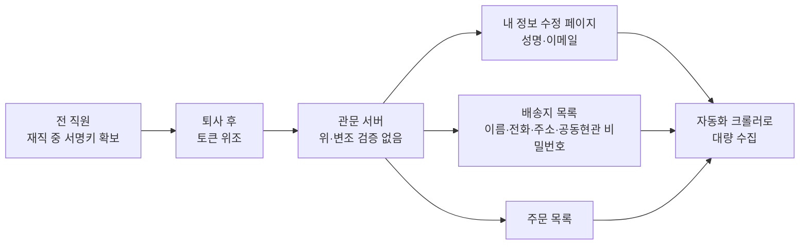

## 0. 한 줄 요약

쿠팡에서 인증 시스템을 개발하던 직원이 재직 중에 서명키를 확보했고, 퇴사한 뒤 이 키로 **인증 토큰(전자 출입증)을 위조**하여 로그인 절차 없이 고객 계정 정보를 약 7개월 동안 수집했다. 정부 조사단과 개인정보보호위원회는 이 사고를 "고도화된 해킹이 아닌 기본 관리 부실"로 결론지었다.

| 항목 | 내용 |
|---|---|
| 공격 기간 | 2025.04.14 ~ 2025.11.08 (약 7개월) |
| 인지 시점 | 2025.11.16 공격자가 보낸 이메일로 인지 |
| 공격자 | 인증 시스템을 설계·개발했던 전 직원 |
| 핵심 원인 | 서명키 관리 부실, 토큰 위·변조 검증 부재, 이상 접근 탐지 실패 |
| 유출 규모 (개인정보위 확정) | 회원 약 3,322만 명 + 비회원 최소 433만 명, 합계 약 3,756만 명 |
| 제재 | 과징금 총 6,246억 8,100만 원 (유출 관련 4,235억 7,500만 원), 과태료 1,680만 원 |

---

## 1. 사건 타임라인

| 일시 | 사건 |
|---|---|
| 2024년 말 ~ 2025년 초 | 공격자가 쿠팡에서 퇴사함 (CISO 청문회 진술 기준) |
| 2025.04.14 | 위조 토큰을 이용한 본격적인 정보 수집이 시작됨 |
| 2025.11.08 | 확인된 마지막 공격 활동 |
| 2025.11.16 | 공격자가 쿠팡에 유출 사실을 알리는 이메일을 보냄 (11.25에 한 차례 더 발송) |
| 2025.11.17 16:00 | 쿠팡 CISO에게 보고됨 |
| 2025.11.19 | 해당 서명키를 폐기함 |
| 2025.11.19 21:35 | KISA에 침해사고를 신고함 (법정 기한인 24시간 초과) |
| 2025.11.19 | 정부가 쿠팡에 자료 보전 명령을 내림 |
| 2025.11.29 | 약 3,370만 계정 유출 사실을 공개함 |
| 2025.12.17 | 국회 과방위 청문회가 열림 |
| 2025.12.25 | 쿠팡이 자체 조사 결과를 발표함 ("공격자가 저장한 정보는 약 3,000건") |
| 2025.12.29 | 1인당 5만 원 상당, 총 1조 6,850억 원 규모의 구매 이용권 보상안을 발표함 |
| 2026.02.10 | 과기정통부 민관합동조사단이 조사 결과를 발표함 |
| 2026.06.10 | 개인정보보호위원회가 과징금 6,246억 원을 의결함 (역대 최대) |

---

## 2. 공격은 어떻게 이루어졌나

### 2-1. "전자 출입증"과 서명키

대부분의 웹 서비스는 사용자가 로그인하면 서버가 **서명된 토큰**을 발급하고, 이후 요청마다 그 토큰을 확인하여 사용자를 식별한다. 토큰의 무결성은 오직 **서명키**에 의존한다. 서명키를 가진 사람은 서버가 발급한 것과 구별할 수 없는 토큰을 마음대로 만들 수 있다.

쿠팡 사고는 이 전제가 무너진 사례였다. 공격자는 재직 중에 **장애 대비용 백업 인증 시스템**을 설계·개발했고, 그 시스템의 서명키를 탈취했다. 쿠팡은 퇴사자가 다루던 서명키를 갱신하지 않았기 때문에, 공격자는 퇴사한 뒤에도 유효한 토큰을 직접 생성할 수 있었다.

### 2-2. 공격 절차

조사단이 발표한 내용을 정리하면 공격은 다음 순서로 진행되었다.

1. **사전 테스트**: 퇴사 후 본격적인 공격에 앞서 위조 토큰이 통과하는지 시험했고, 수집한 정보를 해외 클라우드로 전송할 수 있는지도 확인했다.
2. **토큰 위조**: 탈취한 서명키로 토큰을 만들어 관문(게이트웨이) 서버를 통과했다. 조사단은 공격자가 접속할 때마다 새로 서명한 토큰을 만든 것으로 파악했다.
3. **대량 수집**: 자동화된 웹 크롤링 도구로 고객 정보 페이지를 반복 조회했다. 과기정통부 발표에 따르면 공격에는 2,313개 IP가 사용되었다.
4. **존재하지 않는 계정**: 개인정보위 조사에 따르면 실제로 존재하지 않는 회원 계정의 토큰 약 4,400만 개가 접속에 사용되었는데도 쿠팡은 6개월 이상 이를 인지하지 못했다.

### 2-3. 무엇이 조회되었나

| 페이지 | 포함된 정보 | 규모 (조사단 기준) |
|---|---|---|
| 내 정보 수정 | 성명, 이메일 | 3,367만 3,817건 유출 |
| 배송지 목록 | 성명, 전화번호, 주소, 비식별 처리된 공동현관 비밀번호 | 약 1억 4,805만 회 조회 |
| 배송지 목록 수정 | 위와 같음 + 공동현관 비밀번호 | 5만 474회 조회 |
| 주문 목록 | 최근 주문 상품 | 10만 2,682회 조회 |

배송지 목록에는 회원이 등록해 둔 **가족·지인의 정보**도 들어 있었다. 그래서 개인정보위는 최종적으로 비회원 최소 433만 명을 피해자에 포함했다.

---

## 3. 근본 원인 분석

### 원인 1. 서명키가 "키 관리 시스템"을 벗어나 있었다

내부 규정상 서명키는 키 관리 시스템(KMS)에만 보관하도록 되어 있었다. 그러나 포렌식 결과, 현직 개발자의 노트북에도 서명키가 저장된 흔적이 발견되었다. 개인정보위는 서명키가 암호화되지 않은 상태로 보관되었다고 판단했다. 이는 규정이 존재했지만 **기술적으로 강제되지 않았다**는 의미이다.

### 원인 2. 키의 생명주기 관리가 없었다

- 키 발급 이력을 관리하지 않아서, 키가 원래 목적과 다르게 사용되는지 파악할 수 없었다.
- 키 수명은 3년으로 정해져 있었지만, 세부적인 교체 절차는 마련되어 있지 않았다.
- **퇴사자가 접근하던 키를 교체하는 절차가 없었다.** 국회 청문회에서 쿠팡 CISO는 "마스터키가 11개월 동안 탈취된 상태였느냐"는 질의에 "맞다"고 답했다.

### 원인 3. 개발 환경과 운영 환경이 분리되지 않았다

개발자가 실제 운영 키 관리 시스템에 접근할 수 있는 구조였다. 직무 분리(Separation of Duties)가 지켜지지 않았기 때문에, 인증 시스템을 만든 사람이 곧 운영 키를 손에 넣을 수 있었다. 조사단은 ISMS-P 인증 기준 중 직무 분리와 암호키 관리 항목이 미달되었다고 밝혔다.

### 원인 4. 관문 서버에 토큰 위·변조 검증이 부족했다

관문 서버는 토큰이 정상적으로 발급되었는지, 즉 "실제 로그인 절차를 거쳐 발급된 토큰인지"를 확인하지 않았다. 서명만 맞으면 통과시켰기 때문에, 존재하지 않는 계정의 토큰이 수천만 개 들어와도 차단되지 않았다.

### 원인 5. 모의해킹 결과를 "개별 패치"로만 처리했다

조사단에 따르면 이 인증 우회 취약점은 이전 모의해킹에서도 지적되었다. 쿠팡은 발견된 문제만 개별적으로 수정했고, 토큰이 공격 경로로 악용될 수 있다는 **구조적인 문제**는 점검하지 않았다.

### 원인 6. 이상 징후 탐지가 작동하지 않았다

7개월 동안 수천 개의 IP에서 1억 회가 넘는 조회가 발생했는데도 쿠팡은 공격자가 직접 이메일을 보내기 전까지 사고를 인지하지 못했다. 반복되는 식별번호, 존재하지 않는 계정의 토큰, 비정상적인 조회량은 모두 탐지 규칙으로 잡을 수 있는 신호였다.

---

## 4. 사고 이후의 대응

### 4-1. 쿠팡의 대응

- 2025.11.19에 문제의 서명키를 폐기했다.
- 2025.12.25에 자체 조사 결과를 발표하며 "공격자가 실제로 저장한 정보는 약 3,000건이고 외부로 전송되지 않은 채 삭제되었다"고 주장했다.
- 2025.12.29에 1인당 5만 원 상당(총 1조 6,850억 원)의 구매 이용권 보상안을 발표했다.
- 청문회에서 2026년 상반기까지 한국 서비스에 **패스키(passkey)** 를 도입하겠다고 밝혔다.

### 4-2. 정부의 대응

- **과기정통부 민관합동조사단 (2026.02.10)**: 25.6TB 분량의 웹 접속 기록을 분석하여 3,367만 건 유출을 확인했다. 토큰 발급·사용 추적, 이상 접근 탐지 강화, 보안 정책 준수 여부의 정기 점검, 충분한 로그 보존을 재발 방지 대책으로 요구했다.
- **개인정보보호위원회 (2026.06.10)**: 유출 관련 과징금 4,235억 7,500만 원과, 타사 웹·앱 활동 기록 무단 수집에 대한 과징금 2,011억 원을 합쳐 총 6,246억 8,100만 원을 부과했다. 인증 체계 전반의 키 관리 개편, 비회원 유출 통지, 처분 결과 공표를 시정명령으로 내렸다.

---

## 5. 대응에서 미흡했던 부분

### 5-1. "조회"와 "유출"을 둘러싼 축소 논란

쿠팡은 공격자가 **저장한** 건수만을 기준으로 약 3,000건이라고 발표했다. 반면 조사단 부단장(KISA)은 "관리자의 통제권을 벗어나면 모두 유출"이라는 입장을 밝혔고, 결과적으로 양측이 발표한 수치는 1만 배 이상 차이가 났다. 피해 규모를 좁게 해석하여 발표한 것은 사고 대응의 신뢰도를 크게 떨어뜨렸다.

### 5-2. 신고 지연

CISO는 11월 17일 오후 4시에 보고를 받았지만, KISA 신고는 11월 19일 오후 9시 35분에 이루어졌다. 정보통신망법이 요구하는 24시간 기한을 넘겼다.

### 5-3. 증거 보전 실패

자료 보전 명령이 내려진 뒤에도 자동 로그 삭제 정책을 조정하지 않아서 2024년 7~11월의 웹 접속 기록 약 5개월분이 사라졌고, 2025년 5월 말~6월 초의 앱 접속 기록도 삭제되었다. 개인정보위는 이를 조사 방해로 보고 수사기관에 고발했다. 침해사고 대응(IR)에서 **증거 보전은 초기 대응의 첫 단계**인데, 이 단계부터 실패한 것이다.

### 5-4. 비회원 통지 거부

정부가 여러 차례 요구했는데도 쿠팡은 비회원 피해자에게 유출 사실을 통지하지 않았다. 배송지 목록에 이름이 올라 있던 가족·지인은 자신의 정보가 유출되었는지조차 알 수 없었다.

### 5-5. 보상안의 실효성

보상안은 총액 기준으로 역대 최대 규모였지만, 현금이 아니라 쿠팡 내부 서비스별로 나누어 쓰는 구매 이용권이었다. 실제로 자주 쓰는 서비스에서 자유롭게 사용할 수 있는 금액은 일부에 그쳤기 때문에, 시민단체와 업계에서는 보상이 아니라 마케팅에 가깝다는 비판이 나왔다.

---

## 6. 이 사고에서 배운 점

개발자와 보안 담당자의 입장에서 다음 사항을 점검할 수 있다.

- [ ] **서명키를 사람이 꺼낼 수 없게 만든다.** HSM이나 클라우드 KMS의 서명 API를 사용하면, 애플리케이션은 키 자체가 아니라 "서명 요청"만 할 수 있다. 키를 파일로 내려받을 수 있다면 언젠가는 노트북에 저장된다.
- [ ] **키에 식별자(kid)와 발급 이력을 남긴다.** 어떤 키로 서명된 토큰이 언제, 어디서 쓰였는지 추적할 수 있어야 목적 외 사용을 발견할 수 있다.
- [ ] **퇴사·전보 시 키를 교체한다.** 계정 비활성화만으로는 부족하다. 그 사람이 접근할 수 있었던 비밀값(서명키, API 키, 공용 계정 비밀번호)을 모두 교체 대상으로 관리해야 한다.
- [ ] **서명 검증 외에 "발급 사실"도 확인한다.** 토큰 ID를 서버 측에 기록해 두고, 발급 기록이 없는 토큰이나 존재하지 않는 사용자의 토큰을 거부한다.
- [ ] **백업·장애 대비 경로를 같은 수준으로 보호한다.** 이 사고의 출발점은 주 인증 시스템이 아니라 백업 인증 시스템이었다. 평소에 잘 쓰이지 않는 경로일수록 감시가 약해진다.
- [ ] **모의해킹 결과를 구조적으로 분석한다.** 개별 취약점을 수정하는 데서 끝내지 말고, 그 취약점이 가능했던 설계상의 원인을 함께 찾는다.
- [ ] **IR 플레이북에 "로그 자동 삭제 중지"를 포함한다.** 사고를 인지하는 즉시 보존 정책을 동결해야 한다.

---

## 참고 자료

- 바이라인네트워크, [쿠팡 3367만건 고객정보 유출 공식 확인](https://byline.network/2026/02/10-611/) (2026.02.10)
- 뉴시스, [쿠팡 유출자, 고객 배송지 목록 1억4000건 들춰봤다](https://www.newsis.com/view/NISX20260210_0003509704) (2026.02.10)
- 뉴시스, [쿠팡 VS 정부 조사단 개인정보 유출 건수 차이나는 이유](https://www.newsis.com/view/NISX20260210_0003510149) (2026.02.10)
- 아이뉴스24, [쿠팡 민관합동조사단 일문일답](https://www.inews24.com/v/mtl/1938043) (2026.02.10)
- 디지털데일리, [책임자 없는 '맹탕' 청문회](https://www.ddaily.co.kr/page/view/2025121719081593057) (2025.12.17)
- 대한민국 정책브리핑, [쿠팡(주), 역대 최대 과징금 총 6246억 8100만 원 부과](https://www.korea.kr/news/policyNewsView.do?newsId=148966578) (2026.06.11)
- 뉴시스, [회원 가족·지인 434만명도 털렸다](https://www.newsis.com/view/NISX20260611_0003665194) (2026.06.11)
- 머니투데이, [쿠팡에 과징금 6247억원](https://www.mt.co.kr/tech/2026/06/11/2026061110281865375) (2026.06.11)
- 뉴시스, [쿠팡 '역대 최대' 보상안에도 싸늘](https://www.newsis.com/view/NISX20251229_0003458252?pc_view=1) (2025.12.29)
