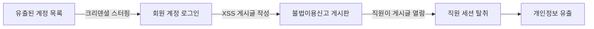

> **한 줄 요약**: 해커가 게시판에 심은 XSS로 직원 세션을 탈취해 9만 5천여 명의 개인정보를 빼냈다. 법원은 "웹방화벽에 XSS 차단 정책이 있었는데도 켜지 않았고, 게시판 입력값 검증도 하지 않았다"며 과징금 6억 1,300만 원이 적법하다고 판단했다.
{: .prompt-info }

## 1. 판례 정보

| 항목 | 내용 |
|---|---|
| 사건번호 | 서울행정법원 2024구합70753 과징금부과처분등취소청구의소 |
| 법원 | 서울행정법원 제14부 (재판장 이상덕) |
| 선고일 | 2025. 8. 14. |
| 당사자 | 원고: 디지털대성(대성마이맥 운영사) / 피고: 개인정보보호위원회 |
| 결론 | 원고 청구 기각 (과징금 6억 1,300만 원과 공표명령이 적법함) |
| 판결문 | [국가법령정보센터 판결 원문](https://www.law.go.kr/LSW//precInfoP.do?precSeq=609539) |
| 현재 상태 | 원고가 항소하여 아직 확정되지 않았다. |

이 판결을 고른 이유는 두 가지다. 첫째, 2023년 개정 개인정보보호법의 과징금 기준(전체 매출액 기준)이 처음 적용된 제재에 대해 법원이 내린 판단이다. 둘째, XSS와 크리덴셜 스터핑처럼 웹 해킹을 공부하면 반드시 만나는 공격이 법적으로 어떻게 평가되는지 구체적으로 보여 준다.

## 2. 사건 경과와 문제가 된 개인정보

### 2-1. 타임라인

| 날짜 | 사건 |
|---|---|
| 2024. 1. 12. | 해커가 크리덴셜 스터핑으로 회원 계정 로그인에 성공했다. |
| 2024. 1. 15. | 해커가 그 계정으로 '불법이용신고 게시판'에 XSS 명령어가 담긴 게시글을 작성했다. |
| 2024. 1. 16. | 직원이 게시글을 열람하면서 직원 계정의 세션정보가 탈취되었다. |
| 2024. 1. 18. | 회사가 개인정보 유출을 신고했다. |
| 2024. 3. 27. | 개인정보위가 과징금 6억 1,300만 원, 과태료 330만 원, 공표명령을 부과했다. |
| 2025. 8. 14. | 서울행정법원이 회사의 청구를 기각했다. |

### 2-2. 공격 흐름

공격 자체는 새로운 기법이 아니다. 다른 곳에서 유출된 계정으로 로그인한 뒤, 직원이 반드시 확인하는 신고 게시판에 Stored XSS를 심어 관리 권한이 있는 세션을 가로챈 구조다.

### 2-3. 유출된 개인정보

- **대상**: 직원 25명, 회원 95,171명
- **항목**: ID, 일부가 가려진 이름, 휴대전화번호, 이메일 주소
- **보유 규모**: 회사는 당시 약 113만 건의 개인정보를 보유하고 있었다.
- 주 이용자가 입시를 준비하는 청소년이라는 점에서, 개인정보위는 더 각별한 주의가 필요했다고 지적했다.

## 3. 쟁점별 양측 주장과 법원 판단

### 쟁점 ① 안전조치의무를 위반했는가

| 원고(회사) | 법원 |
|---|---|
| ISMS 인증을 받았고 웹방화벽, UTM, DB 접근제어, 보안관제를 운영했다. 학생 서비스 특성상 XSS 자동차단과 로그인 횟수 제한을 완화했을 뿐이며, 공격을 탐지한 뒤 IP를 차단했다. | 웹방화벽이 XSS 탐지·차단 정책을 기본 제공했는데도 적용하지 않았다. 게시판에 입력값 검증도 하지 않았다. 사후 IP 차단은 예방 조치가 될 수 없다. 로그인 성공·실패 비율로 비정상 로그인을 파악할 수 있으므로 횟수 제한도 어려운 조치가 아니다. |

법원은 입력값 검증 같은 XSS 자동차단 정책이 "당시 기술수준으로 충분히 구현 가능"했다고 보았다. 회사가 내세운 IP 차단에 대해서는 이렇게 판단했다.

> "이는 이미 발생한 해킹에 관한 사후적 수습에 불과할 뿐, XSS 공격 자체를 예방하거나 차단하기 위한 충분한 안전성 확보조치로 볼 수는 없다."

법원은 오탐 우려도 예외 설정으로 관리할 수 있다고 보았다. 즉 **보안 솔루션을 "도입"한 것과 "제대로 설정"한 것은 다르다**는 판단이다.

### 쟁점 ② 과징금 계산에 쓸 매출액은 어디까지인가

- **원고**: 강사 몫 교재 매출, 외부 교재와 오프라인 모의고사 매출, 결합상품 매출은 개인정보 유출과 관련이 없으므로 빼야 한다.
- **법원**: 유출된 개인정보를 보유·관리하는 서비스 범위에서 나온 매출은 모두 포함된다. 강사에게 나눠 주는 금액은 회사 내부의 사후 정산일 뿐이다.

### 쟁점 ③ 위반기간은 언제부터 언제까지인가

- **원고**: 과징금 조항이 '유출'을 요건으로 하므로, 위반기간은 실제 유출이 있었던 5일이다.
- **법원**: 위반기간은 안전조치의무를 위반한 기간이다. 유출 기간을 기준으로 하면 해커가 얼마나 오래 공격했는지 같은 우연한 사정으로 과징금이 달라진다.

그 결과 게시판 입력값 검증을 하지 않은 2016. 4. 16.부터 처분일까지 약 8년이 위반기간이 되었고, 2년을 넘는 위반이라 과징금이 50% 가중되었다.

### 쟁점 ④ 과징금 액수와 공표명령은 과도한가

| 단계 | 금액 |
|---|---|
| 기준금액 | 7억 3,075만 원 |
| 1차 조정 (장기 위반 50% 가중, 이득 없음 30% 감경) | +1억 4,615만 원 |
| 2차 조정 (조사 협력 30% 감경) | −2억 6,307만 원 |
| **최종 과징금** (100만 원 미만 버림) | **6억 1,300만 원** |

법원은 피해 규모가 경미하지 않고, ID도 다른 정보와 결합하면 개인정보가 된다고 보았다. 공표명령도 위반기간이 8년에 이르고 다수의 정보주체가 피해를 입었다는 점에서 비례원칙에 어긋나지 않는다고 판단했다.

### 판단에 쓰인 법 조항

| 구분 | 조항 | 내용 |
|---|---|---|
| 법률 | 개인정보 보호법 제29조 | 안전조치의무 |
| 법률 | 같은 법 제64조의2 제1항 제9호 | 안전조치를 하지 않아 유출된 경우 과징금 |
| 법률 | 같은 법 제66조 제2항 | 공표명령 |
| 시행령 | 제30조 제1항 제3호 가목, 제8호 | 침입 탐지·차단, 그 밖의 안전성 확보 조치 |
| 고시 | 개인정보의 안전성 확보조치 기준 제6조 제1항 제2호 | IP 주소 등을 분석한 유출 시도 탐지·대응 |
| 고시 | 같은 기준 제6조 제3항 | 홈페이지를 통한 유출 방지 조치 |

## 4. 상급심과 법 개정 이후의 검토

### 4-1. 상급심

원고가 항소했지만, 이 글을 쓰는 시점까지 항소심 결과는 확인하지 못했다. 그래서 상급심 비교 대신 과거 대법원 판례와 판단 기준을 비교했다.

| 구분 | 네이트·싸이월드 사건 (대법원 2018. 1. 25. 선고 2015다24904) | 대성마이맥 사건 (2025) |
|---|---|---|
| 적용 법 | 구 정보통신망법, 2011년 보호조치 고시 | 개인정보보호법 제29조, 통합 안전성 확보조치 기준 |
| 판단 기준 | 고시는 최소 기준이고, 사회통념상 합리적으로 기대되는 조치까지 봄 | 같은 기준을 사용함 |
| 결론 | 계정이 이미 탈취되어 인과관계가 없다며 회사 책임 부정(민사) | 기본 제공 정책도 켜지 않았다며 회사 책임 인정(행정) |

두 판결은 같은 "합리적 기대" 기준을 쓴다. 차이는 **회사가 할 수 있었던 조치를 했는가**에 있었다. 네이트 사건은 고도의 공급망 공격이었고, 대성마이맥 사건은 알려진 공격을 이미 가진 장비로 막을 수 있었다. 또한 민사 손해배상은 피해자가 인과관계를 입증해야 하지만, 과징금은 안전조치를 다하지 않은 사실만으로 부과될 수 있다는 점도 결론을 갈랐다.

### 4-2. 2026년 개정법을 적용하면

2026. 9. 11. 시행된 개정법은 과징금 상한을 일정한 경우 전체 매출액의 10%까지 높였다. 대상은 고의·중과실에 의한 3년 내 반복 위반, 1천만 명 이상의 대규모 피해, 시정명령 불이행 등이다.

- **10% 상한**: 이 사건은 피해자가 약 9만 5천 명이고 반복 위반도 아니므로 해당하지 않을 가능성이 높다. 위반 판단 자체는 지금 기준으로도 같다.
- **투자감경**: 평소 보호 투자를 했다면 과징금을 최대 40%까지 줄일 수 있다. 회사는 ISMS 인증과 여러 보안 솔루션을 갖추고 있었으므로 감경 요소가 될 수 있다. 다만 정책을 켜지 않은 상태로 장비만 있었다는 점이 어떻게 평가될지는 지켜볼 부분이다.
- **통지 의무**: 대통령령으로 정하는 경우에는 유출 '가능성'만 있어도 72시간 안에 정보주체에게 통지해야 한다. 이 회사는 유출 통지 의무 위반도 함께 지적받았으므로, 지금 기준이라면 더 엄격하게 평가될 것이다.

## 5. 내 의견

**판결에 동의한다.** XSS는 OWASP Top 10에 오랫동안 올라 있던 공격이고, 입력값 검증과 웹방화벽 정책은 가장 기본적인 대응이다. 이미 구매한 웹방화벽의 기본 정책조차 켜지 않았다면 "합리적으로 기대되는 조치"를 했다고 보기 어렵다. ISMS 인증이나 보안관제 계약이 있다는 사실만으로는 면책되지 않는다는 점도 타당하다.

**아쉬운 점도 있다.** 위반기간을 '안전조치를 하지 않은 기간'으로 보면, 오래된 서비스일수록 과징금이 크게 가중된다. 이 사건에서는 8년 전부터 위반이 시작된 것으로 계산되었다. 기술 기준이 계속 바뀌는 상황에서 언제부터 "의무 위반"이었는지를 어떻게 정할지는 항소심에서 다시 다툴 만한 쟁점이라고 생각한다.

### 실무에서 참고할 점

- 웹방화벽 같은 보안 솔루션은 도입했는지보다 정책이 실제로 켜져 있는지가 중요하다. 오탐이 걱정되면 정책을 끄지 말고 예외 규칙으로 관리한다.
- **직원이 보는 화면이 공격 대상이다.** 신고 게시판, 고객 문의, 관리자 페이지처럼 직원이 사용자 입력을 열람하는 곳은 Stored XSS의 1순위 표적이다. 입력값 검증뿐 아니라 출력 인코딩과 세션 쿠키 보호(HttpOnly 등)도 함께 점검해야 한다.
- 이 사건의 첫 단계는 크리덴셜 스터핑이었다. IP별 로그인 시도 제한, 성공·실패 비율 모니터링, 다중 인증으로 첫 진입부터 막아야 한다.
- 공격을 탐지하고 IP를 차단한 것만으로는 면책되지 않는다. 법원은 이를 예방 조치로 인정하지 않았다.
- **보안 투자와 운영 기록을 남긴다.** 2026년 개정법의 투자감경은 사고 이전의 투자와 운영 실적을 기준으로 평가한다.

## 6. 참고 자료

- [서울행정법원 2025. 8. 14. 선고 2024구합70753 판결 (국가법령정보센터)](https://www.law.go.kr/LSW//precInfoP.do?precSeq=609539)
- [비즈한국, "대성마이맥 개인정보 113만 건 유출, 행정법원 '6억 원대 과징금 적법'"](https://www.bizhankook.com/bk/article/30189)
- [보안뉴스, "개인정보 유출된 교육기업 디지털대성 및 하이컨시, 과징금·과태료 약 9억 부과" (2024. 3. 28.)](https://www.boannews.com/news/articleView.html?idxno=128283)
- [대법원 2018. 1. 25. 선고 2015다24904 판결 원문](https://www.scourt.go.kr/sjudge/1517209566408_160606.pdf)
- [법무법인 율촌, "매출액 10% 과징금·대표자 책임 강화 등 개정 개인정보 보호법 시행" (법률신문, 2026. 9. 15.)](https://www.lawtimes.co.kr/news/articleView.html?idxno=226414)
- [법무법인 화우, "개인정보 사고, '평소 투자'가 과징금을 가른다" (법률신문, 2026. 9. 17.)](https://www.lawtimes.co.kr/news/articleViewAmp.html?idxno=226493)
- [머니투데이, "개인정보 유출 과징금, 매출액 최대 3→10%" (2026. 9. 10.)](https://www.mt.co.kr/tech/2026/09/10/2026091008562069877)