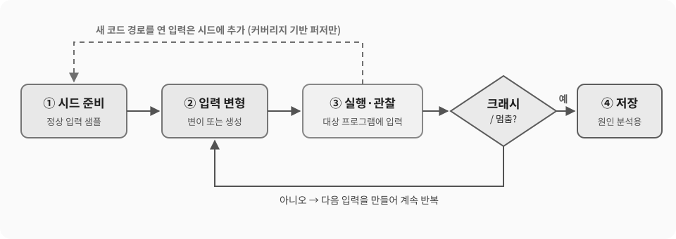
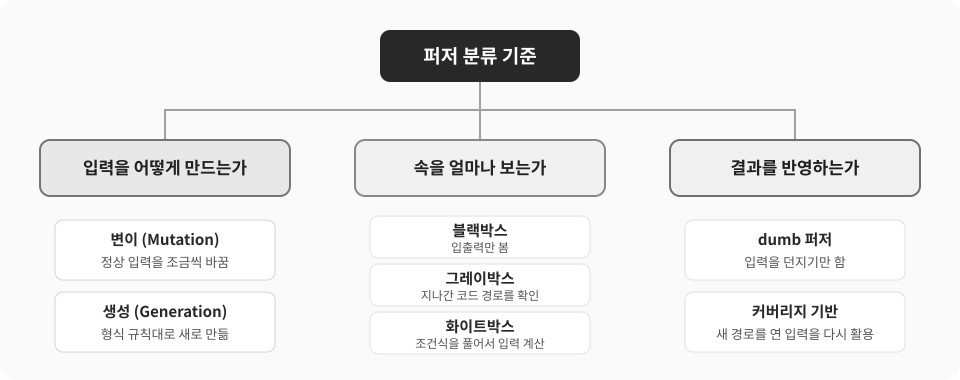

취약점 관련 글이나 CVE 리포트를 읽다 보면 "퍼징으로 찾았다"는 말이 정말 자주 나온다. 그동안 대충 "랜덤 입력 넣어 보는 거" 정도로만 알고 있었는데, 이번 기회에 퍼징이 정확히 뭔지, 퍼저는 어떤 종류가 있고 서로 뭐가 다른지 한번 정리해 봤다.

## 1. 퍼징(Fuzzing)이란

자판기를 테스트한다고 생각하면 쉽다. 보통 사람은 동전 넣고 버튼 누르고 끝이지만, 테스터는 찌그러진 동전도 넣어 보고 외국 동전도 넣어 보고 버튼 10개를 동시에 눌러 보기도 한다. 이런 이상한 짓을 수천 번 하다 보면 자판기가 고장 나는 순간이 나온다.

퍼징은 이걸 프로그램한테 자동으로 하는 거다. 프로그램에 이상한 입력을 엄청 많이 넣어 보고, 프로그램이 죽는(crash) 순간을 찾는다. 프로그램이 죽었다는 건 개발자가 예상 못 한 상황이 생겼다는 뜻이고, 거기에 공격에 쓸 수 있는 취약점이 숨어 있는 경우가 많다. 그리고 이 작업을 대신 해 주는 도구가 퍼저(fuzzer)다.

이름의 유래도 재밌다. 1988년 위스콘신 대학의 Barton Miller 교수가 천둥번개 치는 날 모뎀으로 원격 접속을 했는데, 회선에 노이즈가 섞여 들어오면서 유닉스 유틸리티들이 줄줄이 죽어 버렸다고 한다. 이걸 보고 "랜덤 입력으로 프로그램을 테스트해 보자"는 과제를 수업에 낸 게 퍼징의 시작이다.

_퍼저가 일하는 기본 순서_

퍼저가 돌아가는 순서를 정리하면 이렇다.

1. **시드(seed) 준비**: 정상적인 입력 샘플을 몇 개 준비한다.
2. **입력 변형**: 시드를 조금씩 바꾸거나, 규칙에 따라 새 입력을 만든다.
3. **실행하고 지켜보기**: 만든 입력을 프로그램에 넣고 크래시나 멈춤(hang)이 생기는지 본다.
4. **저장**: 문제를 일으킨 입력은 따로 저장해 뒀다가 나중에 원인을 분석한다.

그림 위쪽의 점선은 뒤에서 설명할 커버리지 기반 퍼저에만 해당하는 부분이다.

## 2. 퍼저는 어떻게 나눌까

찾아보니 퍼저는 보통 세 가지 기준으로 나눈다.

_퍼저를 나누는 세 가지 기준_

### 2.1 입력을 어떻게 만드는가

**변이(Mutation) 방식**은 멀쩡한 파일을 하나 가져와서 일부 바이트를 바꾸거나 지워 가며 입력을 만든다. 정상 사진 파일 중간을 엉망으로 바꿔서 이미지 뷰어에 넣어 보는 식이다. 만들기 쉽고 사전 지식도 필요 없는데, 형식 검사가 깐깐한 프로그램에서는 입구에서 바로 튕겨 나간다는 게 단점이다.

**생성(Generation) 방식**은 입력 형식의 규칙(문법)을 퍼저한테 알려 주고, 그 규칙에 맞는 입력을 처음부터 만들게 한다. 형식을 지키니까 프로그램 안쪽까지 잘 들어가지만, 규칙을 사람이 직접 써 줘야 해서 준비가 꽤 귀찮다.

### 2.2 프로그램 속을 얼마나 들여다보는가

- **블랙박스(Black-box)**: 속은 아예 안 보고 입력이랑 출력만 본다. 눈 감고 자판기 버튼 아무거나 누르는 느낌이다.
- **그레이박스(Grey-box)**: 실행하면서 "이번 입력이 코드의 어느 길을 지나갔는지" 정도만 살짝 확인한다. 요즘 제일 많이 쓰는 방식이다.
- **화이트박스(White-box)**: 코드를 수학 문제처럼 풀어서 "이 if문 통과하려면 입력이 정확히 이 값이어야 한다"를 계산해 낸다. 정확하긴 한데 엄청 느리다.

### 2.3 실행 결과를 보고 똑똑해지는가

아무 생각 없이 입력을 계속 던지기만 하는 퍼저를 **dumb 퍼저**라고 부른다. 반대로 어떤 입력이 처음 보는 코드 경로를 열었으면 그 입력을 기억해 뒀다가 그걸 다시 변형하는 퍼저를 **커버리지 기반(coverage-guided) 퍼저**라고 한다.

_dumb 퍼저와 커버리지 기반 퍼저가 도달하는 깊이 차이_

미로 탐험할 때 새 갈림길 찾은 곳에 표시해 두고, 다음엔 거기서부터 다시 탐색하는 거랑 비슷하다. 그래서 그냥 랜덤으로 던지는 것보다 훨씬 빨리 프로그램 깊숙한 곳까지 들어간다. 요즘 많이 쓰는 퍼저는 대부분 이 방식이다.

## 3. 대표적인 퍼저들

### AFL (American Fuzzy Lop)

커버리지 기반 퍼징을 유명하게 만든 원조 퍼저다. 컴파일할 때 분기마다 감시 코드를 심어 두고, 실행하면서 어느 경로를 지나갔는지 기록해서 새 경로를 연 입력을 골라낸다. 원본 AFL은 2017년쯤 개발이 멈췄다.

### AFL++

AFL을 커뮤니티가 이어받아서 개선한 버전이고, 지금은 사실상 AFL을 대체했다. 소스 코드가 없는 바이너리도 QEMU 같은 에뮬레이터를 써서 퍼징할 수 있고, 특정 값이랑 비교하는 조건문을 더 잘 뚫도록 돕는 기능도 들어가 있다. 입문용으로 실습해 보기에 제일 무난해 보인다.

### libFuzzer

LLVM에 들어 있는 퍼저다. 매번 프로그램 전체를 실행하는 게 아니라, 퍼징하고 싶은 함수 하나를 `LLVMFuzzerTestOneInput()` 안에서 계속 호출하는 방식이다. 프로세스를 새로 안 띄우니까 속도가 엄청 빨라서 라이브러리 퍼징할 때 많이 쓴다.

### honggfuzz

Google에서 만든 퍼저로, 여러 퍼징 작업을 동시에 돌리는 데 강하다. 소프트웨어 방식 말고도 CPU의 하드웨어 기능으로 실행 경로를 수집할 수 있다는 게 특징이다.

### syzkaller

운영체제 커널을 노리는 퍼저다. 주로 리눅스 커널에 쓰지만 FreeBSD, OpenBSD 같은 다른 OS도 지원한다. 시스템 콜(프로그램이 운영체제한테 보내는 요청)을 이상한 순서와 값으로 조합해서 호출하고, 커널이 죽는지 본다. 가상 머신을 여러 대 띄워 놓고 동시에 퍼징하고, 시스템 콜 형식을 미리 정의해 둔 다음 입력을 만든다. 생성 방식에 커버리지 기반을 합친 형태라고 보면 된다.

### boofuzz / Peach

네트워크 프로토콜을 노리는 생성 방식 퍼저다. 패킷 구조를 직접 정의해 두고, 필드 값을 바꿔 가면서 서버에 이상한 패킷을 보낸다. boofuzz는 옛날에 많이 쓰던 Sulley의 후속 프로젝트다.

### Radamsa

제일 단순한 블랙박스 변이 퍼저다. 파일을 넣으면 망가뜨린 버전을 뱉어 주는 도구라서, 다른 스크립트랑 엮어서 가볍게 쓰기 좋다.

### 한눈에 비교

| 퍼저 | 대상 | 입력 생성 | 피드백 | 특징 |
|---|---|---|---|---|
| AFL | 일반 프로그램 | 변이 | 커버리지 | 커버리지 기반 퍼징의 원조 |
| AFL++ | 일반 프로그램, 바이너리 | 변이 | 커버리지 | AFL 개선판, 현재 표준 |
| libFuzzer | 라이브러리 함수 | 변이 | 커버리지 | 함수 단위로 빠르게 반복 |
| honggfuzz | 일반 프로그램 | 변이 | 커버리지 | 병렬 실행, 하드웨어 피드백 |
| syzkaller | OS 커널 (주로 리눅스) | 생성 | 커버리지 | 시스템 콜 조합 생성 |
| boofuzz | 네트워크 프로토콜 | 생성 | 거의 없음 | 패킷 구조 정의 |
| Radamsa | 범용 | 변이 | 없음 | 단순한 블랙박스 도구 |

앞에서 본 분류 기준으로 퍼저들을 배치해 보면 이렇게 된다.

_입력 생성 방식과 피드백 여부로 나눈 퍼저 지도_

> 처음에 헷갈렸던 건데, **OSS-Fuzz**는 퍼저가 아니다. libFuzzer, AFL++, honggfuzz 같은 퍼저를 오픈소스 프로젝트에 대해 24시간 돌려 주는 Google의 퍼징 인프라다.
{: .prompt-info }

## 4. 정리

- 퍼징은 이상한 입력을 자동으로 잔뜩 만들어서 프로그램이 죽는 지점을 찾는 기법이다.
- 퍼저는 입력을 만드는 방식(변이/생성), 속을 얼마나 보는지(블랙/그레이/화이트박스), 결과를 반영하는지(dumb/커버리지 기반)로 나눌 수 있다.
- 요즘 주류는 변이 방식의 커버리지 기반 그레이박스 퍼징이고, AFL++와 libFuzzer가 대표적이다.
- 커널이나 네트워크 프로토콜처럼 입력 형식이 딱 정해진 대상은 syzkaller, boofuzz 같은 생성 방식 퍼저를 쓴다.

개념만 보면 단순한데 퍼저마다 노리는 대상이나 설계가 꽤 달라서, 다음에는 직접 하나 골라서 돌려 보면서 감을 잡아 봐야겠다.

## 참고 자료

- [The Fuzzing Book](https://www.fuzzingbook.org/)
- [AFLplusplus GitHub](https://github.com/AFLplusplus/AFLplusplus)
- [libFuzzer 공식 문서](https://llvm.org/docs/LibFuzzer.html)
- [honggfuzz GitHub](https://github.com/google/honggfuzz)
- [syzkaller GitHub](https://github.com/google/syzkaller)
- [boofuzz GitHub](https://github.com/jtpereyda/boofuzz)