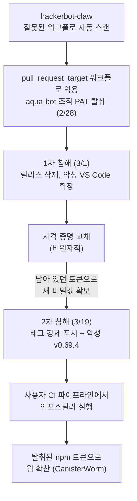

## 0. 한 줄 요약

Aqua Security의 오픈소스 취약점 스캐너 **Trivy**가 두 단계에 걸쳐 침해되었다. 2026년 2월 말, 자동화된 공격 봇이 잘못 설정된 GitHub Actions 워크플로를 통해 조직 전체에 쓰이는 토큰을 탈취했다. 3월 1일 Aqua는 자격 증명을 교체했지만 **교체가 원자적으로(한꺼번에) 이루어지지 않았고**, 공격자는 남아 있던 접근 권한으로 3월 19일 `trivy-action` 버전 태그 77개 중 76개를 악성 커밋으로 바꿔치기했다. 이 태그를 참조하던 수많은 CI 파이프라인에서 비밀값이 유출되었다.

| 항목 | 내용 |
|---|---|
| 식별자 | GHSA-69fq-xp46-6x23, CVE-2026-33634 (CWE-506) |
| 공격 그룹 | TeamPCP (최초 침투는 `hackerbot-claw` 계정의 자동화 캠페인) |
| 최초 침투 | 2026년 2월 말, `pull_request_target` 워크플로 악용 |
| 본 공격 | 2026.03.19 ~ 03.23 |
| 영향 범위 | `trivy` v0.69.4, `trivy-action` 76개 태그, `setup-trivy` 7개 태그 전부, Docker Hub 0.69.5·0.69.6 이미지 |
| 근본 원인 | 비원자적 자격 증명 교체, 가변(mutable) 태그 참조, 과도한 권한의 장기 토큰 |

> 이 사고는 해외 오픈소스 생태계에서 발생했지만, 국내 기업의 CI/CD 파이프라인에도 Trivy가 널리 쓰이기 때문에 영향 범위가 국경에 한정되지 않는다.

---

## 1. 사건 타임라인

| 일시 (UTC) | 사건 |
|---|---|
| 2025.10 | 취약한 워크플로가 Trivy 저장소에 존재하기 시작함 |
| 2025.11.29 | Boost Security의 정적 분석 도구 poutine이 해당 워크플로를 위험으로 표시함 (악용보다 3개월 이상 앞섬) |
| 2026.02.20 | `hackerbot-claw` 계정이 생성됨 |
| 2026.02.28 | 취약한 워크플로를 통해 `aqua-bot` 서비스 계정의 조직 범위 PAT(`ORG_REPO_TOKEN`)가 탈취됨 |
| 2026.03.01 | 1차 침해: 저장소를 일시적으로 비공개로 바꾸고 v0.27.0~v0.69.1 릴리스를 삭제함. OpenVSX에 악성 VS Code 확장을 배포함. Aqua가 침해를 공개하고 자격 증명을 교체함 |
| 2026.03.03~04 | Trivy와 trivy-action에 GitHub 불변 릴리스(immutable releases)가 적용됨 |
| 2026.03.19 17:43 | 2차 침해: `trivy-action` 76개 태그와 `setup-trivy` 7개 태그가 악성 커밋으로 강제 푸시됨. 악성 태그 푸시로 릴리스 파이프라인이 실행됨 |
| 2026.03.19 18:22 | 악성 `trivy` v0.69.4가 배포됨 |
| 2026.03.19 ~21:42 | v0.69.4가 회수됨 (노출 약 3시간) |
| 2026.03.20 ~05:40 | `trivy-action` 태그가 복구됨 (노출 약 12시간) |
| 2026.03.22 15:43 | 별도로 탈취된 Docker Hub 자격 증명으로 악성 0.69.5, 0.69.6 이미지가 게시됨 |
| 2026.03.22 ~21:40 | Aqua 내부 저장소들이 공개 저장소로 게시됨 (봉쇄 이후 공격자가 접근을 회복했다는 증거) |
| 2026.03.23 | Wiz Research가 `kics-github-action`의 병행 침해를 발견함. Aqua가 포렌식 업체 Sygnia를 투입함 |
| 2026.03.24 ~ 04.01 | 자격 증명 재교체, 포렌식 검증, 복구 작업이 진행됨 |

---

## 2. 공격은 어떻게 이루어졌나



### 2-1. 1단계: `pull_request_target`의 함정

GitHub Actions의 `pull_request_target` 트리거는 포크(fork)에서 올라온 PR에 반응하지만, **PR의 브랜치가 아니라 원본(base) 저장소의 컨텍스트에서 실행된다.** 그래서 원본 저장소의 비밀값(secrets)에 접근할 수 있다. 원래는 PR에 라벨을 붙이거나 댓글을 다는 것처럼 PR 코드를 실행하지 않는 작업을 위한 기능이다.

문제는 이 트리거를 쓰면서 PR 쪽 코드를 체크아웃하고 실행하는 경우이다. 그러면 외부인이 보낸 PR 코드가 원본 저장소의 비밀값을 가진 채로 실행된다.


```yaml
# 위험한 패턴 (예시)
on: pull_request_target
jobs:
  test:
    runs-on: ubuntu-latest
    steps:
      - uses: actions/checkout@v4
        with:
          ref: ${{ github.event.pull_request.head.sha }}  # 외부 PR 코드를 가져옴
      - run: make test   # 외부 코드가 비밀값을 가진 채 실행됨
        env:
          TOKEN: ${{ secrets.ORG_REPO_TOKEN }}
```


`hackerbot-claw`는 공개 저장소에서 이런 설정을 자동으로 찾아다니는 캠페인을 벌였고, Microsoft, DataDog, CNCF 프로젝트 등과 함께 Aqua Security도 표적이 되었다. (Snyk의 분석은 Trivy 워크플로가 정확히 어떤 방식으로 체크아웃했는지까지는 밝히지 않았다. 위 예시는 이 공격 유형을 설명하기 위한 일반적인 패턴이다.)

탈취된 토큰은 `aqua-bot` 서비스 계정의 **조직 범위 PAT**였고, Aqua 조직 안에서 최소 33개 워크플로가 이 토큰을 사용하고 있었다. 하나의 토큰이 조직 전체의 열쇠 역할을 하고 있었던 것이다.

### 2-2. 2단계: 비원자적 자격 증명 교체

3월 1일 Aqua는 침해를 공개하고 비밀값을 교체했다. 그러나 공식 권고문은 이 교체가 **원자적이지 않았다**고 인정했다. 모든 자격 증명을 동시에 폐기하지 않았기 때문에, 며칠 동안 아직 유효한 토큰을 가진 공격자가 **새로 발급된 비밀값까지 훔칠 수 있었다.** 열쇠를 하나씩 바꾸는 동안, 아직 바꾸지 않은 열쇠로 들어와 새 열쇠를 복사해 간 셈이다.

### 2-3. 3단계: 가변 태그 바꿔치기

많은 사용자가 워크플로에서 다음처럼 **버전 태그**로 액션을 참조한다.

```yaml
- uses: aquasecurity/trivy-action@0.28.0
```

Git 태그는 커밋을 가리키는 이름표일 뿐이고, 저장소 쓰기 권한이 있으면 **다른 커밋을 가리키도록 강제로 옮길 수 있다.** 공격자는 `trivy-action`의 태그 77개 중 76개를 악성 커밋으로 옮겼다. 사용자는 워크플로를 한 줄도 바꾸지 않았는데, 다음 실행부터 악성 코드가 돌았다. 불변 릴리스가 적용된 v0.35.0만 영향을 받지 않았다.

### 2-4. 4단계: 페이로드 분석

악성 `entrypoint.sh`는 **정상 Trivy 스캔보다 먼저** 실행되었고, 이후 실제 스캔도 정상적으로 수행했다. 그래서 파이프라인은 평소처럼 성공한 것으로 보였다.

| 실행 환경 | 동작 |
|---|---|
| GitHub 호스팅 러너 | 비밀번호 없는 sudo로 `Runner.Worker` 프로세스 메모리를 `/proc/<pid>/mem`에서 덤프하여, 비밀값으로 표시된 JSON 패턴을 추출함 |
| 셀프 호스팅 러너 | SSH 키, 클라우드·Kubernetes 설정, Docker 인증 정보, DB 연결 문자열, Terraform state, `.env`, TLS 키, 셸 히스토리 등 50개 이상의 경로를 수색함 |
| 개발자 PC | systemd 사용자 유닛으로 Python 드로퍼를 설치하여, 공격자 엔드포인트에서 추가 페이로드를 주기적으로 받아오는 지속성을 확보함 |

수집한 데이터는 AES-256-CBC로 암호화하고 키를 RSA-4096으로 감싼 뒤, 타이포스쿼팅 도메인으로 HTTPS POST 전송했다. 전송에 실패하면 **피해자 자신의 GitHub PAT로 `tpcp-docs-`로 시작하는 공개 저장소를 만들어** 데이터를 릴리스 파일로 올리는 대체 경로도 있었다.

GitHub Actions는 로그에서 비밀값을 `***`로 가려 주지만, 그것은 출력 단계의 마스킹일 뿐이다. 비밀값은 실행 중에 러너 프로세스 메모리에 평문으로 존재하므로, 같은 러너에서 실행되는 코드는 이를 읽을 수 있다.

### 2-5. 5단계: 악성 바이너리 v0.69.4

공격자는 `actions/checkout` 참조를 위장 커밋으로 바꾸어, 타이포스쿼팅 도메인에서 악성 Go 소스를 내려받게 만들었다. 또한 GoReleaser에 `--skip=validate` 옵션을 추가하여 검증 단계를 건너뛰었다. 이렇게 만들어진 v0.69.4는 GitHub 릴리스, GHCR, ECR Public, Docker Hub, deb/rpm 저장소로 배포되었다. 반면 공식 Homebrew 포뮬러는 소스에서 직접 빌드하기 때문에 백도어가 포함되지 않았다.

### 2-6. 피해 확산

- StepSecurity는 1만 2천 개가 넘는 공개 저장소에서 공격자 서버로 향하는 외부 연결을 탐지했다.
- Fluent Bit, k8gb, HL7 FHIR IG Publisher, Canonical Charmed Kubeflow 등이 보안 알림을 받았다.
- 공격자는 탈취한 npm 배포 토큰으로 자기 복제형 웜(CanisterWorm)을 퍼뜨려 npm 패키지로 공격을 확장했다.
- Aqua의 IaC 스캐너 액션인 `kics-github-action`도 병행해서 침해되었다.

---

## 3. 근본 원인 분석

### 원인 1. 위험한 워크플로가 3개월 넘게 방치되었다

`pull_request_target` 워크플로는 2025년 10월부터 존재했고, 11월 말에는 정적 분석 도구가 이를 위험으로 표시했다. 경고가 있었지만 조치로 이어지지 않았다.

### 원인 2. 하나의 장기 토큰에 과도한 권한이 몰려 있었다

조직 범위 PAT 하나가 33개 이상의 워크플로에서 공유되고 있었다. 이 토큰은 태그 푸시, 릴리스 생성, 저장소 공개 설정 변경까지 가능했다. 만료되지 않는 장기 토큰 하나가 조직 전체의 단일 실패 지점(SPOF)이었다.

### 원인 3. 자격 증명 교체가 원자적이지 않았다

이 사고에서 가장 중요한 교훈이다. 1차 침해를 공개하고 대응까지 했는데도 2차 침해가 일어났다. 공격자가 이미 내부에 있을 때 자격 증명을 순차적으로 교체하면, **공격자는 교체 과정 자체를 관찰하고 새 자격 증명을 가져갈 수 있다.**

### 원인 4. 생태계 전체가 가변 태그를 신뢰했다

사용자 대부분이 커밋 SHA가 아니라 버전 태그로 액션을 참조했다. 태그는 언제든 옮길 수 있으므로, 공급자 저장소가 침해되는 순간 모든 사용자가 함께 침해된다.

### 원인 5. CI 러너가 비밀값의 보물창고였다

CI 러너에는 클라우드 자격 증명, 배포 토큰, 레지스트리 인증 정보가 모여 있다. 보안 스캐너처럼 "신뢰받는 도구"는 같은 러너에서 넓은 권한으로 실행되기 때문에, 공격자에게 가장 좋은 침투 지점이 된다.

---

## 4. 사고 이후의 대응

Aqua Security는 다음 조치를 취했다.

- GitHub 릴리스, Docker Hub, GHCR, ECR에서 악성 릴리스와 이미지를 삭제했다.
- 침해된 태그를 모두 삭제하거나 검증된 커밋으로 다시 지정했고, `trivy-action`의 태그를 `v` 접두사가 붙은 새 태그로 교체했다.
- 오픈소스 조직 전체의 자동화, 서비스 계정, 토큰을 잠그고 다시 교체했다.
- 토큰 권한을 축소하고 장기 토큰을 없애는 작업을 시작했다.
- 불변 릴리스 검증과 출처 증명(provenance attestation)을 도입하기 시작했다.
- 포렌식 업체 Sygnia를 투입하여 로그를 검증했다.
- 안전한 버전(trivy v0.69.2·v0.69.3, trivy-action v0.35.0, setup-trivy v0.2.6)을 안내하고, Sigstore/cosign으로 바이너리를 검증하는 방법과 IOC(파일 해시, 이미지 다이제스트, C2 도메인·IP)를 공개했다.
- 상용 제품은 GitHub 기반 빌드와 저장소·CI/CD·비밀값·서명 체계를 공유하지 않아 영향을 받지 않았다고 밝혔다.

---

## 5. 대응에서 미흡했던 부분

### 5-1. 1차 대응이 2차 침해를 막지 못했다

3월 1일의 공개와 교체는 빠른 대응처럼 보였지만, 결과적으로 공격자에게 새 비밀값을 넘겨준 셈이 되었다. 침해 범위를 완전히 파악하기 전에 "교체 완료"로 판단한 것이 가장 큰 실책이었다.

### 5-2. 봉쇄 이후에도 공격자가 돌아왔다

3월 19일에 봉쇄를 선언한 뒤에도, 3월 22일에 악성 Docker Hub 이미지가 올라오고 내부 저장소가 공개되었다. 공격자가 확보한 자격 증명의 전체 목록을 파악하지 못했다는 의미이다. Aqua 스스로도 이 사건을 "봉쇄된 사고"가 아니라 "진행 중인 캠페인"으로 다루라고 권고했다.

### 5-3. 보안 기능에 대한 과신

Aqua는 GitHub의 "Immutable" 배지가 태그 강제 푸시를 막아 주지 못했다고 밝혔다. 불변 릴리스는 적용 이후에 생성된 릴리스만 보호하기 때문에, 이미 존재하던 과거 태그들은 그대로 노출되어 있었다.

### 5-4. 위조 커밋의 이상 신호

위조된 커밋은 서명되지 않았고, 부모 커밋보다 날짜가 앞서는 등 논리적으로 불가능한 이력을 가지고 있었다. 커밋 서명 검증을 강제했다면 걸러낼 수 있는 신호였다.

---

## 6. 이 사고에서 배운 점

### 6-1. 액션 사용자 입장

```yaml
# 태그 대신 전체 커밋 SHA로 고정하고, 사람이 읽을 수 있도록 버전을 주석으로 남긴다
- uses: aquasecurity/trivy-action@<40자리 커밋 SHA>  # v0.35.0
```

- [ ] **서드파티 액션은 전체 커밋 SHA로 고정한다.** Dependabot이나 Renovate를 쓰면 SHA 고정 상태에서도 업데이트를 관리할 수 있다.
- [ ] **컨테이너 이미지는 다이제스트(`@sha256:...`)로 참조한다.**
- [ ] **아티팩트를 사용하기 전에 cosign 등으로 서명을 검증한다.**
- [ ] **워크플로 `permissions`를 최소화한다.** 기본값을 `contents: read`로 두고 필요한 권한만 추가한다.
- [ ] **장기 클라우드 키 대신 OIDC 기반 임시 자격 증명을 쓴다.** 러너가 털려도 짧은 시간 안에 만료된다.
- [ ] **러너의 외부 통신을 제한한다.** 허용 목록 기반 egress 통제가 있었다면 유출 단계에서 차단할 수 있었다.

### 6-2. 메인테이너 입장

- [ ] **`pull_request_target`에서 외부 코드를 실행하지 않는다.** 필요하다면 `pull_request`로 테스트하고, 결과만 별도 워크플로에서 처리한다.
- [ ] **zizmor, poutine 같은 워크플로 정적 분석 도구의 경고를 CI 차단 조건으로 만든다.**
- [ ] **조직 범위 PAT를 GitHub App 토큰처럼 범위가 좁고 수명이 짧은 토큰으로 바꾼다.**
- [ ] **태그 보호 규칙과 불변 릴리스를 처음부터 적용하고, 서명된 커밋만 허용한다.**

### 6-3. 침해사고 대응 입장

- [ ] **자격 증명 교체는 "한꺼번에, 그리고 접근 차단 이후"에 한다.** 먼저 공격자의 현재 접근 경로를 끊고, 영향받은 모든 자격 증명의 목록을 만든 뒤, 일괄 폐기하고 재발급해야 한다.
- [ ] **교체 이후에도 이전 자격 증명이 사용되는지 감시한다.** 폐기한 토큰으로 시도가 들어온다면 아직 누락된 경로가 있다는 신호이다.

---

## 참고 자료

- Aqua Security, [GHSA-69fq-xp46-6x23 보안 권고문](https://github.com/aquasecurity/trivy/security/advisories/GHSA-69fq-xp46-6x23)
- Aqua Security Blog, [Trivy Supply Chain Attack](https://www.aquasec.com/blog/trivy-supply-chain-attack/)
- Snyk, [Trivy GitHub Actions Supply Chain Compromise](https://snyk.io/articles/trivy-github-actions-supply-chain-compromise/)
- Socket, [Trivy Under Attack Again](https://socket.dev/blog/trivy-under-attack-again-github-actions-compromise) (2026.03.20)
- The Hacker News, [Trivy Security Scanner GitHub Actions](https://thehackernews.com/2026/03/trivy-security-scanner-github-actions.html)
- GitGuardian, [Trivy's March Supply Chain Attack Shows Where Secret Exposure Hurts Most](https://blog.gitguardian.com/trivys-march-supply-chain-attack-shows-where-secret-exposure-hurts-most/)
- The New Stack, [How TeamPCP turned Aqua Security's own Trivy scanner into a weapon](https://thenewstack.io/?p=22818343) (2026.03.27)
