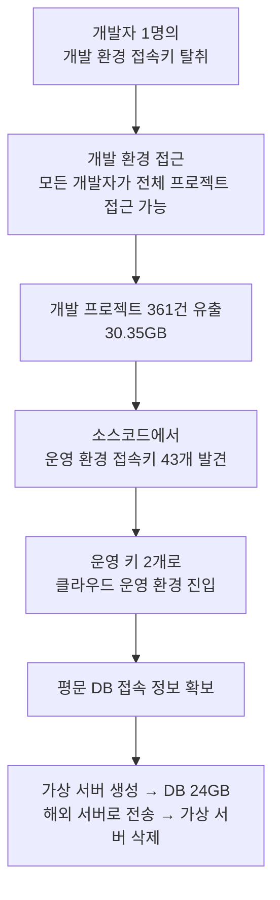

## 0. 한 줄 요약

공격자는 티빙 개발자 한 명의 **개발 환경 접속키**를 손에 넣었고, 그 키로 내려받은 소스코드 안에서 **운영 환경 접속키 43개**를 찾아냈다. 그중 2개를 이용해 클라우드 운영 환경과 고객 DB에 접근했으며, 이틀 만에 개발 프로젝트 361건과 3,954만 개 계정 정보를 빼냈다. 티빙은 2024년 모의해킹에서 같은 유형의 취약점(접속키 하드코딩)을 이미 지적받은 상태였다.

| 항목 | 내용 |
|---|---|
| 공격 기간 | 2026.05.29 ~ 2026.05.31 |
| 인지 시점 (정부 판단) | 2026.05.31 10:10 |
| 최초 침투 | 개발자의 개발 환경 접속키 탈취 (탈취 경로는 미확인) |
| 핵심 원인 | 소스코드 내 운영 키 하드코딩, 과도한 접근 권한, 이상 행위 탐지 부재 |
| 유출 규모 | 계정 3,954만 697개 (중복 포함), 개발 프로젝트 361건(30.35GB) |
| 유출 항목 | 20개 항목 70종 (아이디, 성명, 연락처, 이메일, 생년월일, 성별, CI·DI, 결제 이력 등) |

---

## 1. 사건 타임라인

| 일시 | 사건 |
|---|---|
| 2024년 | 모의해킹에서 접속키가 소스코드에 노출되는 취약점이 발견됨 (이후 개선되지 않음) |
| 2026.05.29 | 탈취한 개발 환경 접속키로 침입하여 개발 프로젝트 361건(30.35GB)을 빼냄 |
| 2026.05.30 | 운영 환경 접속키와 DB 접속 정보로 이용자 정보 유출을 시도함. DB 서버 CPU 사용률이 100%까지 올라가 알람이 발생함 |
| 2026.05.30 18:00 | 티빙이 이상 징후를 포착하고 해당 조회 작업을 차단함. 다만 해킹이 아닌 **시스템 이상**으로 판단하여 추가 조치를 하지 않음 |
| 2026.05.31 | 공격자가 권한이 더 큰 다른 운영 키로 재침투함. 가상 서버를 생성한 뒤 이용자 DB(약 24GB)를 해외 서버로 전송하고 가상 서버를 삭제함. 이때는 CPU 사용률을 10% 이내로 유지함 |
| 2026.05.31 10:10 | 정보보안팀에 운영 키 탈취와 정보 유출 의심 상황이 전달됨 (정부가 인지 시점으로 판단) |
| 2026.06.01 15:08 | KISA에 신고함 (법정 기한인 24시간 초과) |
| 2026.06.03 | 민관합동조사단이 구성됨 |
| 2026.09.03 | 과기정통부가 조사 결과를 발표하고, 같은 날 티빙 대표가 공식 사과와 재발 방지 대책을 발표함 |

---

## 2. 공격은 어떻게 이루어졌나

### 2-1. 1단계: 개발 환경 접속키 탈취

공격의 출발점은 개발자 한 명이 사용하던 개발 환경 접속키였다. 조사단은 해당 개발자를 특정하여 노트북과 PC 등 단말기 9대를 포렌식했고, 피싱·악성코드·공급망 공격·키 공유와 오남용·취약점 악용 시나리오를 모두 검토했다. 그러나 **최초 탈취 경로는 끝내 확인하지 못했다.** 공격자의 신원과 탈취 경로는 경찰 수사로 넘어갔다.

### 2-2. 2단계: 한 사람의 키로 전체 프로젝트에 접근

티빙은 직무와 관계없이 **모든 개발자에게 361개 개발 프로젝트 전체에 대한 접근 권한**을 주고 있었다. 그래서 개발자 한 명의 키만으로 모든 프로젝트를 내려받을 수 있었다. 최소 권한 원칙(Principle of Least Privilege)이 지켜졌다면 피해 범위는 해당 개발자의 담당 프로젝트로 한정되었을 것이다.

### 2-3. 3단계: 소스코드에서 운영 키를 수확

내려받은 프로젝트에는 운영 환경 접속키 43개가 들어 있었다. 41개는 소스코드에 하드코딩되어 있었고, 나머지는 평문 환경 변수 파일에 저장되어 있었다. 공격자는 이 가운데 2개를 실제 공격에 사용했다. 이 단계가 **개발 환경 침해를 운영 환경 침해로 전환시킨 지점**이다.

### 2-4. 4단계: 탐지를 피하는 방식으로 재시도

5월 30일의 1차 시도는 DB 서버의 CPU 사용률을 100%까지 끌어올려 알람을 울렸다. 그러자 공격자는 다음 날 **권한이 더 큰 키**로 다시 들어와서 다음과 같이 방식을 바꾸었다.

- 기존 서버를 쓰지 않고 새 가상 서버를 만들어 작업했다.
- CPU 사용률을 10% 이내로 유지하여 같은 알람이 울리지 않게 했다.
- 전송이 끝난 뒤 가상 서버를 삭제하여 흔적을 줄였다.

### 2-5. 암호화가 의미를 잃은 이유

연락처와 이메일 일부는 암호화되어 있었지만, **암호화 키도 함께 유출되었기 때문에** 조사단은 사실상 평문이 노출된 것과 같다고 판단했다. 비밀번호는 일방향 암호화(해시)되어 있어서 평문으로 복구할 수 없는 상태였다. 데이터와 키를 같은 경계 안에 두면 암호화가 방어선으로서 기능하지 못한다는 점을 보여 준다.

---

## 3. 근본 원인 분석

### 원인 1. 비밀값(Secret)을 소스코드에 저장했다

운영 접속키가 코드와 평문 환경 변수에 들어 있었다. 일부 개발자는 키를 사내 메신저로 공유했고, 키의 발급·사용·변경·폐기를 관리하는 체계도 없었다. 조사단은 이런 방식이 ISMS 인증 기준에 맞지 않는다고 판단했다.

### 원인 2. 알고 있던 취약점을 고치지 않았다

2024년 모의해킹에서 접속키가 소스코드에 노출된다는 문제가 이미 지적되었다. 이 문제가 개선되지 않은 채 남아 있었고, 2년 뒤 실제 공격 경로가 되었다.

### 원인 3. 접근 권한이 과도했다

모든 개발자가 모든 프로젝트에 접근할 수 있었다. 또한 공격자가 2차 시도에서 "권한이 더 큰 키"를 고를 수 있었다는 사실은 운영 키 중 일부가 필요 이상의 권한(예: 가상 서버 생성, DB 전체 접근)을 가지고 있었다는 의미이다.

### 원인 4. 탐지와 판단이 실패했다

- 비정상적인 네트워크 흐름이나 대량 데이터 조회를 실시간으로 탐지·차단하는 체계가 없었다.
- 1차 시도에서 알람이 울렸지만 이를 **장애로 분류**했고, 침해 가능성을 검토하지 않았다.
- 이상 징후를 포착한 시점(5월 30일 18시)부터 정보보호 조직과 CISO에게 공유된 시점까지 약 14시간이 걸렸다.

### 원인 5. 보안 조직의 규모가 작았다

전체 임직원 265명 중 개발 인력이 149명이었지만, 외주를 제외한 정보보호 전담 인력은 4명 안팎이었다.

### 원인 6. 로그 보관 기간이 짧았다

VPN 접속 기록의 보관 기간이 6일에 불과하여, 조사 과정에서 최초 침투 경로를 추적하는 데 한계가 있었다. 최초 탈취 경로가 미확인으로 남은 이유 중 하나로 볼 수 있다.

---

## 4. 사고 이후의 대응

### 4-1. 정부의 대응

- 과기정통부는 신고 지연을 이유로 3,000만 원 이하의 과태료를 부과할 예정이라고 밝혔다.
- 티빙에 재발 방지 이행계획 제출을 요구했고, 접속키 관리·접근 권한 통제·비정상 행위 및 대량 조회 탐지 체계의 강화를 주문했다.
- 2026년 10~12월에 조치 상황을 확인하고, 2027년 1월부터 이행 여부를 점검할 계획이다.
- 개인정보 유출에 따른 과징금은 개인정보보호위원회 조사 이후에 결정된다.

### 4-2. 티빙의 대응 (2026.09.03 발표)

티빙은 사고 약 3개월 만에 대표이사가 공식 사과하고 4대 전략을 발표했다.

1. **정보보호 투자와 인력 확대**: 2030년까지 정보보호 투자를 직전 5년 대비 약 4배로 늘리고(연 100억~120억 원 목표), 보안 인력을 5년 안에 현재의 3배 수준으로 확충한다.
2. **제로 트러스트 기반 보안 체계 재구축**: 보안 조직을 프로덕트 보안, 클라우드 보안, 전사 IT 보안, 컴플라이언스 보안으로 세분화한다.
3. **조직 거버넌스와 보안 문화 재정립**
4. **외부 협력**: CEO 직속 정보보호혁신자문위원회를 발족한다.

고객 보상으로는 해킹·피싱 피해 시 최대 300만 원을 보상하는 안심 보험, 프리미엄급 시청 환경 3개월 제공, 티빙 포인트 등을 내놓았다.

---

## 5. 대응에서 미흡했던 부분

### 5-1. 첫 번째 알람을 놓쳤다

이 사고에서 가장 아쉬운 지점은 5월 30일이다. DB 서버 CPU가 100%까지 치솟은 이유를 조사했다면, 처음 보는 쿼리나 낯선 접속 주체를 발견할 수 있었을 것이다. 티빙은 조회 작업만 차단하고 사용된 키를 회수하지 않았기 때문에, 공격자는 다음 날 다른 키로 같은 목표를 달성했다. **장애 대응 절차와 보안 사고 대응 절차가 연결되어 있지 않았다**는 점이 드러났다.

### 5-2. 키 교체 범위를 판단할 근거가 없었다

키 발급·사용 이력을 관리하지 않았기 때문에, 침해가 의심되는 순간에도 "어떤 키를 회수해야 하는지"를 빠르게 판단하기 어려웠다. 43개 키 중 어떤 키가 어디에 쓰이는지 목록이 있었다면 1차 시도 직후 일괄 회수가 가능했을 것이다.

### 5-3. 신고 지연과 늦은 사과

인지 후 약 29시간 만에 신고했고, 공식 사과는 조사 결과 발표일에 맞추어 사고 약 3개월 뒤에 이루어졌다.

### 5-4. 피해자 수가 불명확하다

티빙은 자체적으로 중복을 제거하여 약 1,953만 명이라고 개인정보보호위원회에 신고했다. 조사단은 CI(연계정보)가 있는 계정 약 1,904만 개를 중복 제거하여 약 1,323만 명을 확인했지만, CI가 없는 약 2,040만 개 계정은 정확한 인원을 산정하지 못했다. 한 사람이 최대 13개 계정을 가진 사례도 확인되었다. 실제 피해자 수는 개인정보보호위원회 조사에서 확정될 예정이다.

---

## 6. 이 사고에서 배운 점

- [ ] **비밀값을 코드와 분리한다.** AWS Secrets Manager, HashiCorp Vault 같은 비밀값 저장소를 사용하고, 애플리케이션은 실행 시점에 비밀값을 받아 오도록 만든다.
- [ ] **장기 접속키 자체를 줄인다.** 클라우드에서는 IAM 역할(Role)과 임시 자격 증명을 사용하면 코드에 넣을 키가 처음부터 존재하지 않는다.
- [ ] **커밋 단계에서 막는다.** gitleaks, trufflehog 같은 비밀값 스캐너를 pre-commit 훅과 CI에 넣어 하드코딩된 키가 저장소에 들어오지 못하게 한다. 이미 저장소 이력에 들어간 키는 삭제가 아니라 **교체**해야 한다.
- [ ] **개발 환경을 운영 환경의 발판으로 만들지 않는다.** 개발 환경에서 얻을 수 있는 정보만으로 운영 환경에 들어갈 수 없어야 한다.
- [ ] **저장소 접근 권한을 팀·직무 단위로 나눈다.** 한 계정이 탈취되었을 때의 피해 범위(blast radius)를 계산해 본다.
- [ ] **"장애"와 "침해"를 함께 의심한다.** 리소스 급증, 처음 보는 쿼리, 새로 생성된 인스턴스는 장애 대응과 동시에 보안 팀에도 공유되도록 절차를 만든다.
- [ ] **데이터와 암호화 키를 분리 보관한다.** 같은 권한으로 둘 다 얻을 수 있다면 암호화는 형식에 그친다.
- [ ] **로그를 충분히 보관한다.** 침투 경로를 밝히려면 수 주에서 수 개월 전의 접속 기록이 필요하다. 6일 보관으로는 대부분의 사고를 재구성할 수 없다.

---

## 참고 자료

- 바이라인네트워크, [티빙, 개발자 '접속키' 방치로 3954만개 이용자 계정 유출](https://byline.network/2026/09/3-454/) (2026.09.03)
- 디지털데일리, [티빙 침해사고 조사 결과](https://m.ddaily.co.kr/page/view/2026090314000838533) (2026.09.03)
- 머니투데이방송, [티빙 해킹 원인은 '접속키' 관리 부실](https://news.mtn.co.kr/news-detail/2026090312021689865) (2026.09.03)
- 아이뉴스24, [티빙 해킹으로 활성 계정 2206만여 개 유출](https://www.inews24.com/view/2001615) (2026.09.03)
- 오마이뉴스, [티빙, '접속키 방치'로 대규모 해킹](https://m.ohmynews.com/NWS_Web/Mobile/at_pg.aspx?CNTN_CD=A0003264290) (2026.09.03)
- 파이낸셜뉴스, [고개 숙인 티빙…보안 투자 4배 늘리고 피싱 피해시 최대 300만원 보상](https://www.fnnews.com/news/202609031600378450) (2026.09.03)
- 디지털데일리, [티빙, 1인당 체감 2만원 보상](https://www.ddaily.co.kr/page/view/2026090318502875113) (2026.09.03)
